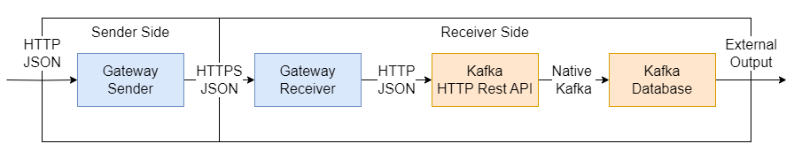
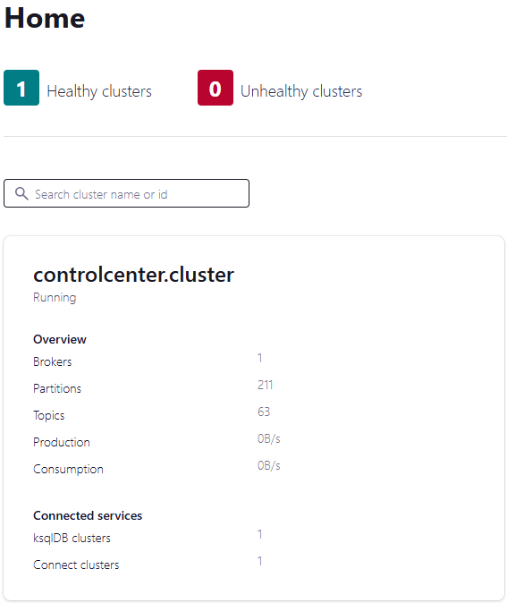
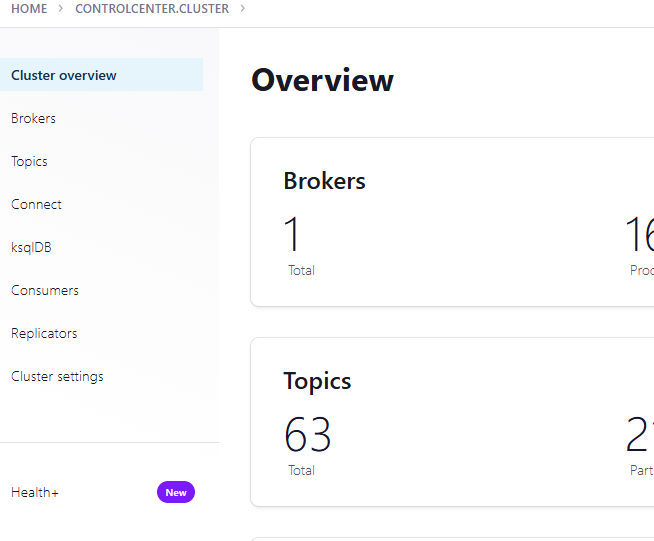
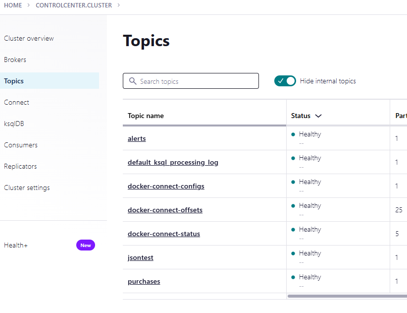
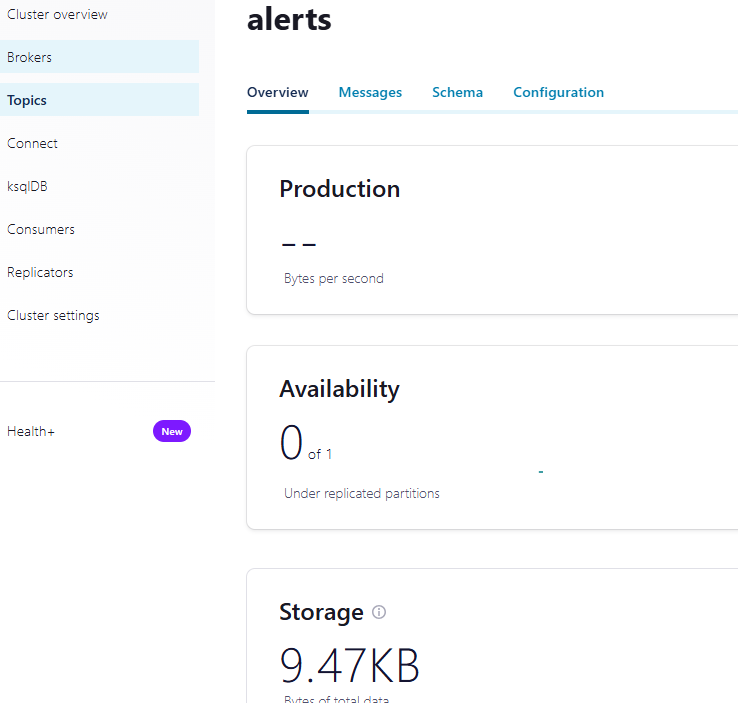
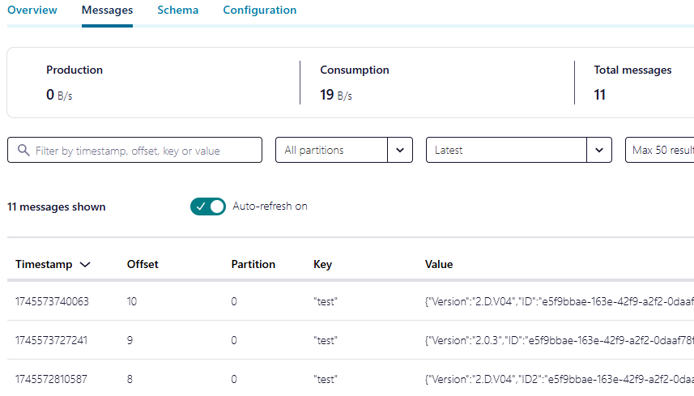

# Safe4Soc Gateway Sender and Receiver

## General Info

This project provides code and testing functionality to create a secure gateway for date transmission 
in the context of the project SAFE4SOC (https://safe4soc.eu/).
It is configured for the IDE Intellij Community Edition.
Is uses GraalVM to produce an executable with faster startup times and less memory footprint during execution.

## Architecture Overview


The gateway consists of a sender gateway on the sender side and the receiving gateway on the receiver side.
Kafka does not natively support JSON objects send via HTTP REST, therefore a translation was provided by the Kafka 
developers to translate HTTP Rest API calls into native Kafka protocol communication.

The sender gateway receives IDMEFv2 as JSON formatet alert message via HTTP message. 
For testing or debugging curl scripts or the postman collection can be used for testing.
The gateway sender afterwards performs configured filtering or enrichment and forwards the 
alert to the receiver side gateway. 
Here the alert is also filtered or enriched as configured and afterwards sent to the Kafka HTTP Rest API container.
The Kafka REST API container does the translation to the final destination, the Kafka database which is locally 
reachable on the receiver side.

## Requirements
To create the image, run the following goal. NOTE: GraalVM 22.3+ is required.
For installation instructions please see 
- Docker and docker-compose must be installed beforehand
- Install GraalVM https://www.graalvm.org/latest/getting-started/
- Install gcc glibc-devel zlib-devel etc. https://www.graalvm.org/latest/reference-manual/native-image/

## Compilation 
In main project's path run
```
./gradlew nativeCompile
```
Then a binary is compiled which is later used for the docker build.
The compilation time takes about 5 minutes on a modern laptop.
You can do a test of the app as follows:
```
build/native/nativeCompile/s4sgateway
```
Then, you can build the docker container image:
```
docker build -t s4sgateway .  
```
Once the image was built these commands can launch the kafka services and the gateways
Launching kafka.
```
docker compose up -d rest-proxy control-center schema-registry broker
docker compose up -d gateway-receiver gateway-sender
```
Launching gateway-sender (separate console recommended)
```
docker compose up gateway-sender 
```
Launching gateway-receiver (separate console recommended)
```
docker compose up gateway-receiver 
```
Afterward, the containers can be tested using postman collection. Get postman here: https://www.postman.com/downloads/
Once installed the testing collection (SAFE4SOC.postman_collection.json) which contains predefined REST API requests 
can be imported via File -> Import.

## Configuration

The gateway must be configured using the file application.properties. 
A different version of this file is used for a gateway taking either the sender or receiver role, 
respectively the files:
- application.properties (for debugging directly in IntelliJ IDE)
- receiver.properties
- sender.properties
- docker.properties (for launch via docker-compose script.)

The files are mapped into the corresponding docker container via docker-compose.yaml.
Please edit config in docker-compose file as otherwise the config will be overwritten.

The following entries must be specified for the gateway in sender mode:
```
gatewayRole=SENDER
```
This switch lets the gateway act as sending gateway. Options are either SENDER or RECEIVER.
```
relevantHeaders={'content-type','accept','user-Agent','accept-Encoding','safe4soc-receiver-hostname','safe4soc-receiver-port'}
```
This array lists headers to be forwarded within the gateway. All other headers are dropped.

### Sender Gateway Properties
```
gatewayDomainRC=localhost
gatewayPortRC=8081
```
These entries specify the destination domain and port of the receiving gateway where messages must be forwarded to.

```
gatewayDomainSD=localhost
gatewayPortSD=8080
```
These entries specify self-information for the gateway, needed for alert entry enrichment, for instance.

### Receiver Gateway Properties
```
kafkaDomainLocal=kafkalocal
kafkaPortLocal=8082
```
These entries identify where the local kafka database can be found.

### SSL Activation or Deactivation (DEBUG Connection Settings)

The gateway has a setting to control the inbound SSL configuration (Spring boot VM settings), 
and the outbound SSL configuration (Java internal SSL Context object).
Both can be activated or deactivated separately using the following flags in docker-compose.

```
      GATEWAY_PROTOCOL: https     # for communication from gateway sender to gateway receiver
      SSL_INBOUND_ACTIVATED: true
      SSL_OUTBOUND_ACTIVATED: true
```

For debug purposes in a testing environment the SSL-settings can be both be set to false. 
This means that neither the initial connection from the outside inside the Gateway-sender nor the forwarding from Gateway-sender to Geteway-receiver will apply HTTPS but only HTTP, which is of course not acceptable for a production environment but ONLY FOR TESTING PURPOSES!
The file docker-compose-debug-http.yaml is properly configured to work out of the box and can be launched using:

```bash
docker compose up -d rest-proxy control-center schema-registry broker 
docker compose -f docker-compose-debug-http.yaml up gateway-sender
docker compose -f docker-compose-debug-http.yaml up gateway-receiver
```

### Information Sharing Agreement Configuration
The entry about the ISA is important, as it also contains the config about necessary filtering and enrichment instructions.
Please note: JSON objects across multiple lines must be formatted with \ at the end of each line is the properties files.

```
isaConfig=\
{\
  "provider_reason": "compliance",\
  "intended_use": "alert_gathering",\
  "data_usage_policies": {\
    "use_until": "2024-12-12",\
    "use_after": "2024-09-12",\
    "share_further": "false"\
  },\
  "data_sender_SIEM_brand": "Example Company A",\
  "data_sender_SIEM_version": "Version 0.1",\
  "IDMEFv2_attributes": {\
    "attributes_to_transmit": [],\
    "attributes_to_neglect": [],\
    "attributes_to_anonymize": [],\
    "attributes_to_pseudonemize": []\
  },\
  "sending_mode": "",\
  "encryption_requirements": [],\
  "authentication_requirements": [],\
  "connection_requirements": [],\
```
The basic attributes above were derived from the requirements specified and might be frequently adapted
in meaning and structure.

```
  "filterConfig": {\
    "Version": "",\
    "ID": "",\
    "Status": "",\
    "OrganisationName": "",\
    "CreateTime": "",\
    "StartTime": "",\
    "Cause": "",\
    "Category": "",\
    "Priority": "",\
    "Confidence": "",\
    "Description": "",\
    "Analyzer": {\
      "IP": "",\
      "Name": "",\
      "Hostname": "",\
      "Type": "",\
      "Model": "",\
      "Category": "",\
      "Data": "",\
      "Method": "",\
      "GeoLocation": "",\
      "UnLocation": "",\
      "Location": ""\
    },\
    "Sensor": "",\
    "Source": {\
      "IP": "",\
      "Protocol": ""\
    },\
    "Target": ""\
  },\
```
The Filtering configuration uses a nested list in JSON format.
If identifiers for key value pairs are found, the entry's content is replaced with an empty string ("").
If identifiers for nested objects are found, either the complete object is cleaned, when no sub-entries were given, 
or only the sub entries mentioned are replaced with blank spaces or empty arrays, depending on the element.
The list above is an example of a configuration which filters all entries.

```
  "enrichmentConfig": {\
    "CreateTime": "",\
    "StartTime": ""\
  }\
}
```
The enrichment configuration uses a nested list in JSON format, also.
However, each enrichment functionality must be implemented specifically. 
The class Utils contains a prepared nested case structure for all elements to individually implement 
an enrichment where necessary.

### Filtering and Enrichment Examples

When the Gateway receives the following IDMEFv2 message:
```
{
  "Version": "2.D.V04",
  "ID": "e5f9bbae-163e-42f9-a2f2-0daaf78fefb1",
  "Status": "Incident",
  "OrganisationName": "acme.eu",
  "CreateTime": "",
  "StartTime": "2021-01-18T23:33:04.52Z",
  "Cause": "Malicious",
  "Category": [
    "Recon.Scanning"
  ],
  "Priority": "Medium",
  "Confidence": 0.9,
  "Description": "An IDS event of type \"Unknown IP Protocol\" was observed",
  "Analyzer": {
    "IP": "172.10.5.31",
    "Name": "Core router",
    "Hostname": "core-router.example.com",
    "Type": "Cyber",
    "Model": "Cisco 4532",
    "Category": [
      "NIDS"
    ],
    "Data": [
      "Datagram"
    ],
    "Method": [
      "signature"
    ],
    "GeoLocation": "+48.75726,+2.299528,+65.1",
    "UnLocation": "GR ATH",
    "Location": "SBDX1"
  },
  "Sensor": [
    {
      "IP": "172.10.5.31",
      "Name": "Core router",
      "CaptureZone": "[{\"type\":\"ipv4-addr\",\"spec_version\":\"2.1\",\"id\": \"ipv4-addr--ff26c055-6336-5bc5-b98d-13d6226742dd\",\"value\": \"172.17.0.0\"},{\"type\":\"ipv4-net-mask\",\"spec_version\":\"2.1\",\"id\":\"ipv4-net-mask--ff26c055-6336-5bc5-b98d-13d6226742dd\",\"value\":\"255.255.0.0\"}]"
    }
  ],
  "Source": [
    {
      "IP": "77.222.222.115",
      "Protocol": [
        "Unknown"
      ]
    }
  ],
  "Target": [
    {
      "IP": "172.20.7.25",
      "Port": [
        645
      ],
      "Location": "Datacenter SBX1"
    }
  ]
}
```
and processes it using the configuration from above, the output will be:
```
{
  "Status": "",
  "Category": [],
  "Description": "",
  "Priority": "",
  "CreateTime": "",
  "StartTime": "",
  "Analyzer": {
    "Type": "",
    "Category": [],
    "IP": "",
    "Hostname": "",
    "Model": "",
    "Data": [],
    "UnLocation": "",
    "Method": [],
    "GeoLocation": "",
    "Name": "",
    "Location": ""
  },
  "Source": [],
  "Target": [],
  "Version": "",
  "Confidence": "",
  "Cause": "",
  "OrganisationName": "",
  "ID": "",
  "Sensor": []
}
```
Please note that the fields CreateTime and StartTime are enriched by the gateway, if no entry was found.
Enrichment of timestamps can be made and look like this:
```
  "CreateTime": "2025-04-02T09:16:57.16Z",
  "StartTime": "2025-04-02T09:16:57.69Z",
```

## Setting up the local Demo for IDMEFv2 

To fully demonstrate how alerts are sent to Kafka through the gateway following commands are necessary.
The Kafka github project provides docker samples for all their services running out the box.
Their sample was taken from here: 
https://docs.confluent.io/platform/current/get-started/platform-quickstart.html. 
The docker sample was taken from here:
https://github.com/confluentinc/cp-all-in-one/tree/7.9.0-post/cp-all-in-one/docker-compose.yml

The gateways were added to the docker compose file located in the root folder of the project. 
It can be launched via: 

```
docker-compose up -d rest-proxy control-center schema-registry broker gateway-receiver gateway-sender
```
Please note more services are included in the sample file, such as flink or ksqldb but for the demo they are not needed.

After about a minute the system should be launched and the Kafka dashboard can be reached via web browser at 
```
localhost:9021
```
You should see something similar to this: 
Landing page



Click on controlcenter.cluster



Click on Topics



Click on alerts (if it was already set up correctly). If it is not there yet you can either send the first message via curl or click on the GUI "Add topic" at the top right.



Click on messages to see the current stored messages.



Please note that for Kafke message consumption each message requires a key, in this case it was "test" and the IDMEFv2 alert is stored inside the value filed of the JSON message.
It is also possible to specify a JSON schema for the correct format of the messages, but for this demo it is not required.
Please note that the Kafka rest proxy cannot process IDMEFv2 alerts directly but requires an envelope using a JSON record array and a key and value object as shown below.

To test whether new messages arrive in Kafka you can use this curl command containing an IDMEFv2 alert or the Postman collection provided:

```declarative
curl --location 'http://localhost:8082/topics/alerts' \
--header 'Content-Type: application/vnd.kafka.json.v2+json' \
--data '{
    "records": [
        {
            "key":"test",
            "value":
                {
                    "Version": "2.D.V04",
                    "ID": "e5f9bbae-163e-42f9-a2f2-0daaf78fefb1",
                    "Status": "Incident",
                    "OrganisationName": "acme.eu",
                    "CreateTime": "",
                    "StartTime": "2021-01-18T23:33:04.52Z",
                    "Cause": "Malicious",
                    "Category": [
                        "Recon.Scanning"
                    ],
                    "Priority": "Medium",
                    "Confidence": 0.9,
                    "Description": "An IDS event of type \"Unknown IP Protocol\" was observed",
                    "Analyzer": {
                        "IP": "172.10.5.31",
                        "Name": "Core router",
                        "Hostname": "core-router.example.com",
                        "Type": "Cyber",
                        "Model": "Cisco 4532",
                        "Category": [
                        "NIDS"
                        ],
                        "Data": [
                        "Datagram"
                        ],
                        "Method": [
                        "signature"
                        ],
                        "GeoLocation": "+48.75726,+2.299528,+65.1",
                        "UnLocation": "GR ATH",
                        "Location": "SBDX1"
                    },
                    "Sensor": [
                        {
                        "IP": "172.10.5.31",
                        "Name": "Core router",
                        "CaptureZone": "[{\"type\":\"ipv4-addr\",\"spec_version\":\"2.1\",\"id\": \"ipv4-addr--ff26c055-6336-5bc5-b98d-13d6226742dd\",\"value\": \"172.17.0.0\"},{\"type\":\"ipv4-net-mask\",\"spec_version\":\"2.1\",\"id\":\"ipv4-net-mask--ff26c055-6336-5bc5-b98d-13d6226742dd\",\"value\":\"255.255.0.0\"}]"
                        }
                    ],
                    "Source": [
                        {
                        "IP": "77.222.222.115",
                        "Protocol": [
                            "Unknown"
                        ]
                        }
                    ],
                    "Target": [
                        {
                        "IP": "172.20.7.25",
                        "Port": [
                            645
                        ],
                        "Location": "Datacenter SBX1"
                        }
                    ]
                }
            
        }
    ]
}'
```
Expected Response: 
```
{"offsets":[{"partition":0,"offset":11,"error_code":null,"error":null}],"key_schema_id":null,"value_schema_id":null}
```
At this point the Kafka testing environment is working correctly and alerts can be collected.
To route the traffic through the gateways use the following command and please note the following ports assigned for the localhost sample:
* gateway-sender: 10080
* gateway-receiver: 10081
* kafka-rest: 8082

Send the curl command above to the gateway-sender for initializing the complete demo. 
It will be forwarded to the receiver-gateway and then forwarded to the kafka-rest destination.
```
curl --location 'http://localhost:10080/topics/alerts' \
--header 'Content-Type: application/vnd.kafka.json.v2+json' \
--data '{
  "Version": "2.D.V04",
  "ID": "e5f9bbae-163e-42f9-a2f2-0daaf78fefb1",
  "Status": "Incident",
  "OrganisationName": "acme.eu",
  "CreateTime": "",
  "StartTime": "2021-01-18T23:33:04.52Z",
  "Cause": "Malicious",
  "Category": [
    "Recon.Scanning"
  ],
  "Priority": "Medium",
  "Confidence": 0.9,
  "Description": "An IDS event of type \"Unknown IP Protocol\" was observed",
  "Analyzer": {
    "IP": "172.10.5.31",
    "Name": "Core router",
    "Hostname": "core-router.example.com",
    "Type": "Cyber",
    "Model": "Cisco 4532",
    "Category": [
      "NIDS"
    ],
    "Data": [
      "Datagram"
    ],
    "Method": [
      "signature"
    ],
    "GeoLocation": "+48.75726,+2.299528,+65.1",
    "UnLocation": "GR ATH",
    "Location": "SBDX1"
  },
  "Sensor": [
    {
      "IP": "172.10.5.31",
      "Name": "Core router",
      "CaptureZone": "[{\"type\":\"ipv4-addr\",\"spec_version\":\"2.1\",\"id\": \"ipv4-addr--ff26c055-6336-5bc5-b98d-13d6226742dd\",\"value\": \"172.17.0.0\"},{\"type\":\"ipv4-net-mask\",\"spec_version\":\"2.1\",\"id\":\"ipv4-net-mask--ff26c055-6336-5bc5-b98d-13d6226742dd\",\"value\":\"255.255.0.0\"}]"
    }
  ],
  "Source": [
    {
      "IP": "77.222.222.115",
      "Protocol": [
        "Unknown"
      ]
    }
  ],
  "Target": [
    {
      "IP": "172.20.7.25",
      "Port": [
        645
      ],
      "Location": "Datacenter SBX1"
    }
  ]
}'
```

Tha expected output of the gateway-sender should be:
```
╰─ docker compose up gateway-sender                                                                                                                                                      ─╯
[+] Running 1/1
 ✔ Container safe4soc-gateway-gateway-sender-1  Created                                                                                                                                0.3s
Attaching to gateway-sender-1
gateway-sender-1  |
gateway-sender-1  |   .   ____          _            __ _ _
gateway-sender-1  |  /\\ / ___'_ __ _ _(_)_ __  __ _ \ \ \ \
gateway-sender-1  | ( ( )\___ | '_ | '_| | '_ \/ _` | \ \ \ \
gateway-sender-1  |  \\/  ___)| |_)| | | | | || (_| |  ) ) ) )
gateway-sender-1  |   '  |____| .__|_| |_|_| |_\__, | / / / /
gateway-sender-1  |  =========|_|==============|___/=/_/_/_/
gateway-sender-1  |
gateway-sender-1  |  :: Spring Boot ::                (v3.3.5)
gateway-sender-1  |
gateway-sender-1  | 2025-05-13T21:08:47.487Z  INFO 1 --- [s4s-gateway] [           main] d.f.aisec.s4sgateway.Application         : Starting AOT-processed Application using Java 17.0.5 with PID 1 (/s4sgateway started by root in /)
gateway-sender-1  | 2025-05-13T21:08:47.487Z DEBUG 1 --- [s4s-gateway] [           main] d.f.aisec.s4sgateway.Application         : Running with Spring Boot v3.3.5, Spring v6.1.14
gateway-sender-1  | 2025-05-13T21:08:47.487Z  INFO 1 --- [s4s-gateway] [           main] d.f.aisec.s4sgateway.Application         : No active profile set, falling back to 1 default profile: "default"
gateway-sender-1  | 2025-05-13T21:08:47.528Z  INFO 1 --- [s4s-gateway] [           main] o.s.b.w.embedded.tomcat.TomcatWebServer  : Tomcat initialized with port 10080 (http)
gateway-sender-1  | 2025-05-13T21:08:47.532Z  INFO 1 --- [s4s-gateway] [           main] o.apache.catalina.core.StandardService   : Starting service [Tomcat]
gateway-sender-1  | 2025-05-13T21:08:47.533Z  INFO 1 --- [s4s-gateway] [           main] o.apache.catalina.core.StandardEngine    : Starting Servlet engine: [Apache Tomcat/10.1.31]
gateway-sender-1  | 2025-05-13T21:08:47.546Z  INFO 1 --- [s4s-gateway] [           main] o.a.c.c.C.[Tomcat].[localhost].[/]       : Initializing Spring embedded WebApplicationContext
gateway-sender-1  | 2025-05-13T21:08:47.547Z  INFO 1 --- [s4s-gateway] [           main] w.s.c.ServletWebServerApplicationContext : Root WebApplicationContext: initialization completed in 60 ms
gateway-sender-1  | 2025-05-13T21:08:47.610Z  INFO 1 --- [s4s-gateway] [           main] o.s.b.w.embedded.tomcat.TomcatWebServer  : Tomcat started on port 10080 (http) with context path '/'
gateway-sender-1  | 2025-05-13T21:08:47.613Z  INFO 1 --- [s4s-gateway] [           main] d.f.aisec.s4sgateway.Application         : Started Application in 0.162 seconds (process running for 0.168)
gateway-sender-1  | 2025-05-13T21:08:47.613Z  INFO 1 --- [s4s-gateway] [           main] d.f.aisec.s4sgateway.Controller          : Loading Information Sharing Agreement and Filter settings ...
gateway-sender-1  | 2025-05-13T21:08:47.613Z  INFO 1 --- [s4s-gateway] [           main] d.f.aisec.s4sgateway.Controller          : Loaded this ISA:{"data_usage_policies":{"use_until":"2024-12-12","use_after":"2024-09-12","share_further":"false"},"data_sender_SIEM_version":"Version 0.1","intended_use":"alert_gathering","IDMEFv2_attributes":{"attributes_to_anonymize":[],"attributes_to_neglect":[],"attributes_to_pseudonemize":[],"attributes_to_transmit":[]},"sending_mode":"","encryption_requirements":[],"authentication_requirements":[],"enrichmentConfig":{"CreateTime":"","StartTime":""},"data_sender_SIEM_brand":"Example Company A","connection_requirements":[],"filterConfig":{"CreateTime":"","Cause":"","StartTime":""},"provider_reason":"compliance"}
gateway-sender-1  | 2025-05-13T21:08:47.613Z  INFO 1 --- [s4s-gateway] [           main] d.f.aisec.s4sgateway.Controller          : Checking given configuration for role=SENDER ...
gateway-sender-1  | 2025-05-13T21:08:47.613Z  INFO 1 --- [s4s-gateway] [           main] d.f.aisec.s4sgateway.Controller          : Config gatewaySD=gateway-sender:10080
gateway-sender-1  | 2025-05-13T21:08:47.613Z  INFO 1 --- [s4s-gateway] [           main] d.f.aisec.s4sgateway.Controller          : Config gatewayRC=gateway-receiver:10081
gateway-sender-1  | 2025-05-13T21:08:47.614Z  INFO 1 --- [s4s-gateway] [           main] d.f.aisec.s4sgateway.Controller          : Config relevantHeaders=[content-type, accept, user-Agent, accept-Encoding, safe4soc-receiver-hostname, safe4soc-receiver-port]
gateway-sender-1  | 2025-05-13T21:12:35.610Z  INFO 1 --- [s4s-gateway] [io-10080-exec-2] o.a.c.c.C.[Tomcat].[localhost].[/]       : Initializing Spring DispatcherServlet 'dispatcherServlet'
gateway-sender-1  | 2025-05-13T21:12:35.611Z  INFO 1 --- [s4s-gateway] [io-10080-exec-2] o.s.web.servlet.DispatcherServlet        : Initializing Servlet 'dispatcherServlet'
gateway-sender-1  | 2025-05-13T21:12:35.612Z  INFO 1 --- [s4s-gateway] [io-10080-exec-2] o.s.web.servlet.DispatcherServlet        : Completed initialization in 1 ms
gateway-sender-1  | 2025-05-13T21:12:35.614Z DEBUG 1 --- [s4s-gateway] [io-10080-exec-2] d.f.aisec.s4sgateway.Controller          : Header:content-type Key:application/vnd.kafka.json.v2+json
gateway-sender-1  | 2025-05-13T21:12:35.614Z DEBUG 1 --- [s4s-gateway] [io-10080-exec-2] d.f.aisec.s4sgateway.Controller          : Header:user-agent Key:PostmanRuntime/7.43.4
gateway-sender-1  | 2025-05-13T21:12:35.614Z DEBUG 1 --- [s4s-gateway] [io-10080-exec-2] d.f.aisec.s4sgateway.Controller          : Header:accept Key:*/*
gateway-sender-1  | 2025-05-13T21:12:35.614Z DEBUG 1 --- [s4s-gateway] [io-10080-exec-2] d.f.aisec.s4sgateway.Controller          : Header:postman-token Key:b72ab1b5-38d0-4aa6-a481-bb77ce184cb7
gateway-sender-1  | 2025-05-13T21:12:35.614Z DEBUG 1 --- [s4s-gateway] [io-10080-exec-2] d.f.aisec.s4sgateway.Controller          : Header:host Key:localhost:10080
gateway-sender-1  | 2025-05-13T21:12:35.614Z DEBUG 1 --- [s4s-gateway] [io-10080-exec-2] d.f.aisec.s4sgateway.Controller          : Header:accept-encoding Key:gzip, deflate, br
gateway-sender-1  | 2025-05-13T21:12:35.614Z DEBUG 1 --- [s4s-gateway] [io-10080-exec-2] d.f.aisec.s4sgateway.Controller          : Header:connection Key:keep-alive
gateway-sender-1  | 2025-05-13T21:12:35.614Z DEBUG 1 --- [s4s-gateway] [io-10080-exec-2] d.f.aisec.s4sgateway.Controller          : Header:content-length Key:1449
gateway-sender-1  | 2025-05-13T21:12:35.614Z DEBUG 1 --- [s4s-gateway] [io-10080-exec-2] d.f.aisec.s4sgateway.Controller          : RequestURI /topics/alerts
gateway-sender-1  | 2025-05-13T21:12:35.614Z DEBUG 1 --- [s4s-gateway] [io-10080-exec-2] d.f.aisec.s4sgateway.Controller          : RemotePort 36556
gateway-sender-1  | 2025-05-13T21:12:35.615Z DEBUG 1 --- [s4s-gateway] [io-10080-exec-2] d.f.aisec.s4sgateway.Controller          : LocalPort  10080
gateway-sender-1  | 2025-05-13T21:12:35.615Z DEBUG 1 --- [s4s-gateway] [io-10080-exec-2] d.f.aisec.s4sgateway.Controller          : ServerPort 10080
gateway-sender-1  | 2025-05-13T21:12:35.615Z DEBUG 1 --- [s4s-gateway] [io-10080-exec-2] d.f.aisec.s4sgateway.Controller          : ServerName localhost
gateway-sender-1  | 2025-05-13T21:12:35.615Z DEBUG 1 --- [s4s-gateway] [io-10080-exec-2] d.f.aisec.s4sgateway.Controller          : Body
gateway-sender-1  | {
gateway-sender-1  |   "Version": "2.D.V04",
gateway-sender-1  |   "ID": "e5f9bbae-163e-42f9-a2f2-0daaf78fefb1",
gateway-sender-1  |   "Status": "Incident",
gateway-sender-1  |   "OrganisationName": "acme.eu",
gateway-sender-1  |   "CreateTime": "",
gateway-sender-1  |   "StartTime": "2021-01-18T23:33:04.52Z",
gateway-sender-1  |   "Cause": "Malicious",
gateway-sender-1  |   "Category": [
gateway-sender-1  |     "Recon.Scanning"
gateway-sender-1  |   ],
gateway-sender-1  |   "Priority": "Medium",
gateway-sender-1  |   "Confidence": 0.9,
gateway-sender-1  |   "Description": "An IDS event of type \"Unknown IP Protocol\" was observed",
gateway-sender-1  |   "Analyzer": {
gateway-sender-1  |     "IP": "172.10.5.31",
gateway-sender-1  |     "Name": "Core router",
gateway-sender-1  |     "Hostname": "core-router.example.com",
gateway-sender-1  |     "Type": "Cyber",
gateway-sender-1  |     "Model": "Cisco 4532",
gateway-sender-1  |     "Category": [
gateway-sender-1  |       "NIDS"
gateway-sender-1  |     ],
gateway-sender-1  |     "Data": [
gateway-sender-1  |       "Datagram"
gateway-sender-1  |     ],
gateway-sender-1  |     "Method": [
gateway-sender-1  |       "signature"
gateway-sender-1  |     ],
gateway-sender-1  |     "GeoLocation": "+48.75726,+2.299528,+65.1",
gateway-sender-1  |     "UnLocation": "GR ATH",
gateway-sender-1  |     "Location": "SBDX1"
gateway-sender-1  |   },
gateway-sender-1  |   "Sensor": [
gateway-sender-1  |     {
gateway-sender-1  |       "IP": "172.10.5.31",
gateway-sender-1  |       "Name": "Core router",
gateway-sender-1  |       "CaptureZone": "[{\"type\":\"ipv4-addr\",\"spec_version\":\"2.1\",\"id\": \"ipv4-addr--ff26c055-6336-5bc5-b98d-13d6226742dd\",\"value\": \"172.17.0.0\"},{\"type\":\"ipv4-net-mask\",\"spec_version\":\"2.1\",\"id\":\"ipv4-net-mask--ff26c055-6336-5bc5-b98d-13d6226742dd\",\"value\":\"255.255.0.0\"}]"
gateway-sender-1  |     }
gateway-sender-1  |   ],
gateway-sender-1  |   "Source": [
gateway-sender-1  |     {
gateway-sender-1  |       "IP": "77.222.222.115",
gateway-sender-1  |       "Protocol": [
gateway-sender-1  |         "Unknown"
gateway-sender-1  |       ]
gateway-sender-1  |     }
gateway-sender-1  |   ],
gateway-sender-1  |   "Target": [
gateway-sender-1  |     {
gateway-sender-1  |       "IP": "172.20.7.25",
gateway-sender-1  |       "Port": [
gateway-sender-1  |         645
gateway-sender-1  |       ],
gateway-sender-1  |       "Location": "Datacenter SBX1"
gateway-sender-1  |     }
gateway-sender-1  |   ]
gateway-sender-1  | }
gateway-sender-1  | 2025-05-13T21:12:35.615Z DEBUG 1 --- [s4s-gateway] [io-10080-exec-2] d.f.aisec.s4sgateway.Controller          : Filtering the key CreateTime
gateway-sender-1  | 2025-05-13T21:12:35.615Z DEBUG 1 --- [s4s-gateway] [io-10080-exec-2] d.f.aisec.s4sgateway.Controller          : Filtering the key Cause
gateway-sender-1  | 2025-05-13T21:12:35.615Z DEBUG 1 --- [s4s-gateway] [io-10080-exec-2] d.f.aisec.s4sgateway.Controller          : Filtering the key StartTime
gateway-sender-1  | 2025-05-13T21:12:35.615Z DEBUG 1 --- [s4s-gateway] [io-10080-exec-2] d.f.aisec.s4sgateway.Controller          : Body after Filtering:
gateway-sender-1  | {
gateway-sender-1  |   "Status": "Incident",
gateway-sender-1  |   "Category": ["Recon.Scanning"],
gateway-sender-1  |   "Description": "An IDS event of type \"Unknown IP Protocol\" was observed",
gateway-sender-1  |   "Priority": "Medium",
gateway-sender-1  |   "CreateTime": "",
gateway-sender-1  |   "StartTime": "",
gateway-sender-1  |   "Analyzer": {
gateway-sender-1  |     "Type": "Cyber",
gateway-sender-1  |     "Category": ["NIDS"],
gateway-sender-1  |     "IP": "172.10.5.31",
gateway-sender-1  |     "Hostname": "core-router.example.com",
gateway-sender-1  |     "Model": "Cisco 4532",
gateway-sender-1  |     "Data": ["Datagram"],
gateway-sender-1  |     "UnLocation": "GR ATH",
gateway-sender-1  |     "Method": ["signature"],
gateway-sender-1  |     "GeoLocation": "+48.75726,+2.299528,+65.1",
gateway-sender-1  |     "Name": "Core router",
gateway-sender-1  |     "Location": "SBDX1"
gateway-sender-1  |   },
gateway-sender-1  |   "Source": [{
gateway-sender-1  |     "IP": "77.222.222.115",
gateway-sender-1  |     "Protocol": ["Unknown"]
gateway-sender-1  |   }],
gateway-sender-1  |   "Target": [{
gateway-sender-1  |     "IP": "172.20.7.25",
gateway-sender-1  |     "Port": [645],
gateway-sender-1  |     "Location": "Datacenter SBX1"
gateway-sender-1  |   }],
gateway-sender-1  |   "Version": "2.D.V04",
gateway-sender-1  |   "Confidence": 0.9,
gateway-sender-1  |   "Cause": "",
gateway-sender-1  |   "OrganisationName": "acme.eu",
gateway-sender-1  |   "ID": "e5f9bbae-163e-42f9-a2f2-0daaf78fefb1",
gateway-sender-1  |   "Sensor": [{
gateway-sender-1  |     "CaptureZone": "[{\"type\":\"ipv4-addr\",\"spec_version\":\"2.1\",\"id\": \"ipv4-addr--ff26c055-6336-5bc5-b98d-13d6226742dd\",\"value\": \"172.17.0.0\"},{\"type\":\"ipv4-net-mask\",\"spec_version\":\"2.1\",\"id\":\"ipv4-net-mask--ff26c055-6336-5bc5-b98d-13d6226742dd\",\"value\":\"255.255.0.0\"}]",
gateway-sender-1  |     "IP": "172.10.5.31",
gateway-sender-1  |     "Name": "Core router"
gateway-sender-1  |   }]
gateway-sender-1  | }
gateway-sender-1  | 2025-05-13T21:12:35.615Z DEBUG 1 --- [s4s-gateway] [io-10080-exec-2] d.f.aisec.s4sgateway.Controller          : Enriching the key CreateTime
gateway-sender-1  | 2025-05-13T21:12:35.615Z DEBUG 1 --- [s4s-gateway] [io-10080-exec-2] d.f.aisec.s4sgateway.Controller          : Enriching the key StartTime
gateway-sender-1  | 2025-05-13T21:12:35.615Z DEBUG 1 --- [s4s-gateway] [io-10080-exec-2] d.f.aisec.s4sgateway.Controller          : Body after Enrichment:
gateway-sender-1  | {
gateway-sender-1  |   "Status": "Incident",
gateway-sender-1  |   "Category": ["Recon.Scanning"],
gateway-sender-1  |   "Description": "An IDS event of type \"Unknown IP Protocol\" was observed",
gateway-sender-1  |   "Priority": "Medium",
gateway-sender-1  |   "CreateTime": "2025-05-13T21:12:35.61Z",
gateway-sender-1  |   "StartTime": "2025-05-13T21:12:35.61Z",
gateway-sender-1  |   "Analyzer": {
gateway-sender-1  |     "Type": "Cyber",
gateway-sender-1  |     "Category": ["NIDS"],
gateway-sender-1  |     "IP": "172.10.5.31",
gateway-sender-1  |     "Hostname": "core-router.example.com",
gateway-sender-1  |     "Model": "Cisco 4532",
gateway-sender-1  |     "Data": ["Datagram"],
gateway-sender-1  |     "UnLocation": "GR ATH",
gateway-sender-1  |     "Method": ["signature"],
gateway-sender-1  |     "GeoLocation": "+48.75726,+2.299528,+65.1",
gateway-sender-1  |     "Name": "Core router",
gateway-sender-1  |     "Location": "SBDX1"
gateway-sender-1  |   },
gateway-sender-1  |   "Source": [{
gateway-sender-1  |     "IP": "77.222.222.115",
gateway-sender-1  |     "Protocol": ["Unknown"]
gateway-sender-1  |   }],
gateway-sender-1  |   "Target": [{
gateway-sender-1  |     "IP": "172.20.7.25",
gateway-sender-1  |     "Port": [645],
gateway-sender-1  |     "Location": "Datacenter SBX1"
gateway-sender-1  |   }],
gateway-sender-1  |   "Version": "2.D.V04",
gateway-sender-1  |   "Confidence": 0.9,
gateway-sender-1  |   "Cause": "",
gateway-sender-1  |   "OrganisationName": "acme.eu",
gateway-sender-1  |   "ID": "e5f9bbae-163e-42f9-a2f2-0daaf78fefb1",
gateway-sender-1  |   "Sensor": [{
gateway-sender-1  |     "CaptureZone": "[{\"type\":\"ipv4-addr\",\"spec_version\":\"2.1\",\"id\": \"ipv4-addr--ff26c055-6336-5bc5-b98d-13d6226742dd\",\"value\": \"172.17.0.0\"},{\"type\":\"ipv4-net-mask\",\"spec_version\":\"2.1\",\"id\":\"ipv4-net-mask--ff26c055-6336-5bc5-b98d-13d6226742dd\",\"value\":\"255.255.0.0\"}]",
gateway-sender-1  |     "IP": "172.10.5.31",
gateway-sender-1  |     "Name": "Core router"
gateway-sender-1  |   }]
gateway-sender-1  | }
gateway-sender-1  | 2025-05-13T21:12:35.616Z DEBUG 1 --- [s4s-gateway] [io-10080-exec-2] d.f.aisec.s4sgateway.Controller          : Printing headers for forward request
gateway-sender-1  | 2025-05-13T21:12:35.616Z DEBUG 1 --- [s4s-gateway] [io-10080-exec-2] d.f.aisec.s4sgateway.Controller          : application/vnd.kafka.json.v2+json
gateway-sender-1  | 2025-05-13T21:12:35.616Z DEBUG 1 --- [s4s-gateway] [io-10080-exec-2] d.f.aisec.s4sgateway.Controller          : */*
gateway-sender-1  | 2025-05-13T21:12:35.616Z DEBUG 1 --- [s4s-gateway] [io-10080-exec-2] d.f.aisec.s4sgateway.Controller          : Printing forwarded request info: http://gateway-receiver:10081/topics/alerts POST
gateway-sender-1  | 2025-05-13T21:12:35.616Z DEBUG 1 --- [s4s-gateway] [io-10080-exec-2] d.f.aisec.s4sgateway.Controller          : Printing forwarded body: {"Status":"Incident","Category":["Recon.Scanning"],"Description":"An IDS event of type \"Unknown IP Protocol\" was observed","Priority":"Medium","CreateTime":"2025-05-13T21:12:35.61Z","StartTime":"2025-05-13T21:12:35.61Z","Analyzer":{"Type":"Cyber","Category":["NIDS"],"IP":"172.10.5.31","Hostname":"core-router.example.com","Model":"Cisco 4532","Data":["Datagram"],"UnLocation":"GR ATH","Method":["signature"],"GeoLocation":"+48.75726,+2.299528,+65.1","Name":"Core router","Location":"SBDX1"},"Source":[{"IP":"77.222.222.115","Protocol":["Unknown"]}],"Target":[{"IP":"172.20.7.25","Port":[645],"Location":"Datacenter SBX1"}],"Version":"2.D.V04","Confidence":0.9,"Cause":"","OrganisationName":"acme.eu","ID":"e5f9bbae-163e-42f9-a2f2-0daaf78fefb1","Sensor":[{"CaptureZone":"[{\"type\":\"ipv4-addr\",\"spec_version\":\"2.1\",\"id\": \"ipv4-addr--ff26c055-6336-5bc5-b98d-13d6226742dd\",\"value\": \"172.17.0.0\"},{\"type\":\"ipv4-net-mask\",\"spec_version\":\"2.1\",\"id\":\"ipv4-net-mask--ff26c055-6336-5bc5-b98d-13d6226742dd\",\"value\":\"255.255.0.0\"}]","IP":"172.10.5.31","Name":"Core router"}]}
gateway-sender-1  | 2025-05-13T21:12:35.685Z DEBUG 1 --- [s4s-gateway] [io-10080-exec-2] d.f.aisec.s4sgateway.Controller          : Response status code: 200
gateway-sender-1  | 2025-05-13T21:12:35.685Z DEBUG 1 --- [s4s-gateway] [io-10080-exec-2] d.f.aisec.s4sgateway.Controller          : Response body: {"offsets":[{"partition":0,"offset":9,"error_code":null,"error":null}],"key_schema_id":null,"value_schema_id":null}
```

The expected output at gateway receiver should be similar to:

```
╰─ docker compose up gateway-receiver                                                                                                                                                    ─╯
[+] Running 1/1
 ✔ Container safe4soc-gateway-gateway-receiver-1  Created                                                                                                                              0.2s
Attaching to gateway-receiver-1
gateway-receiver-1  |
gateway-receiver-1  |   .   ____          _            __ _ _
gateway-receiver-1  |  /\\ / ___'_ __ _ _(_)_ __  __ _ \ \ \ \
gateway-receiver-1  | ( ( )\___ | '_ | '_| | '_ \/ _` | \ \ \ \
gateway-receiver-1  |  \\/  ___)| |_)| | | | | || (_| |  ) ) ) )
gateway-receiver-1  |   '  |____| .__|_| |_|_| |_\__, | / / / /
gateway-receiver-1  |  =========|_|==============|___/=/_/_/_/
gateway-receiver-1  |
gateway-receiver-1  |  :: Spring Boot ::                (v3.3.5)
gateway-receiver-1  |
gateway-receiver-1  | 2025-05-13T21:09:05.971Z  INFO 1 --- [s4s-gateway] [           main] d.f.aisec.s4sgateway.Application         : Starting AOT-processed Application using Java 17.0.5 with PID 1 (/s4sgateway started by root in /)
gateway-receiver-1  | 2025-05-13T21:09:05.971Z DEBUG 1 --- [s4s-gateway] [           main] d.f.aisec.s4sgateway.Application         : Running with Spring Boot v3.3.5, Spring v6.1.14
gateway-receiver-1  | 2025-05-13T21:09:05.972Z  INFO 1 --- [s4s-gateway] [           main] d.f.aisec.s4sgateway.Application         : No active profile set, falling back to 1 default profile: "default"
gateway-receiver-1  | 2025-05-13T21:09:05.995Z  INFO 1 --- [s4s-gateway] [           main] o.s.b.w.embedded.tomcat.TomcatWebServer  : Tomcat initialized with port 10081 (http)
gateway-receiver-1  | 2025-05-13T21:09:05.996Z  INFO 1 --- [s4s-gateway] [           main] o.apache.catalina.core.StandardService   : Starting service [Tomcat]
gateway-receiver-1  | 2025-05-13T21:09:05.996Z  INFO 1 --- [s4s-gateway] [           main] o.apache.catalina.core.StandardEngine    : Starting Servlet engine: [Apache Tomcat/10.1.31]
gateway-receiver-1  | 2025-05-13T21:09:06.005Z  INFO 1 --- [s4s-gateway] [           main] o.a.c.c.C.[Tomcat].[localhost].[/]       : Initializing Spring embedded WebApplicationContext
gateway-receiver-1  | 2025-05-13T21:09:06.005Z  INFO 1 --- [s4s-gateway] [           main] w.s.c.ServletWebServerApplicationContext : Root WebApplicationContext: initialization completed in 33 ms
gateway-receiver-1  | 2025-05-13T21:09:06.034Z  INFO 1 --- [s4s-gateway] [           main] o.s.b.w.embedded.tomcat.TomcatWebServer  : Tomcat started on port 10081 (http) with context path '/'
gateway-receiver-1  | 2025-05-13T21:09:06.035Z  INFO 1 --- [s4s-gateway] [           main] d.f.aisec.s4sgateway.Application         : Started Application in 0.084 seconds (process running for 0.087)
gateway-receiver-1  | 2025-05-13T21:09:06.036Z  INFO 1 --- [s4s-gateway] [           main] d.f.aisec.s4sgateway.Controller          : Loading Information Sharing Agreement and Filter settings ...
gateway-receiver-1  | 2025-05-13T21:09:06.036Z  INFO 1 --- [s4s-gateway] [           main] d.f.aisec.s4sgateway.Controller          : Loaded this ISA:{"data_usage_policies":{"use_until":"2024-12-12","use_after":"2024-09-12","share_further":"false"},"data_sender_SIEM_version":"Version 0.1","intended_use":"alert_gathering","IDMEFv2_attributes":{"attributes_to_anonymize":[],"attributes_to_neglect":[],"attributes_to_pseudonemize":[],"attributes_to_transmit":[]},"sending_mode":"","encryption_requirements":[],"authentication_requirements":[],"enrichmentConfig":{"CreateTime":"","StartTime":""},"data_sender_SIEM_brand":"Example Company A","connection_requirements":[],"filterConfig":{"CreateTime":"","Cause":"","StartTime":""},"provider_reason":"compliance"}
gateway-receiver-1  | 2025-05-13T21:09:06.036Z  INFO 1 --- [s4s-gateway] [           main] d.f.aisec.s4sgateway.Controller          : Checking given configuration for role=RECEIVER ...
gateway-receiver-1  | 2025-05-13T21:09:06.037Z  INFO 1 --- [s4s-gateway] [           main] d.f.aisec.s4sgateway.Controller          : Config gatewayRC=gateway-receiver:10081
gateway-receiver-1  | 2025-05-13T21:09:06.037Z  INFO 1 --- [s4s-gateway] [           main] d.f.aisec.s4sgateway.Controller          : Config kafkaLocal=rest-proxy:8082
gateway-receiver-1  | 2025-05-13T21:09:06.037Z  INFO 1 --- [s4s-gateway] [           main] d.f.aisec.s4sgateway.Controller          : Config relevantHeaders=[content-type, accept, user-Agent, accept-Encoding, safe4soc-receiver-hostname, safe4soc-receiver-port]
gateway-receiver-1  | 2025-05-13T21:12:35.624Z  INFO 1 --- [s4s-gateway] [io-10081-exec-1] o.a.c.c.C.[Tomcat].[localhost].[/]       : Initializing Spring DispatcherServlet 'dispatcherServlet'
gateway-receiver-1  | 2025-05-13T21:12:35.624Z  INFO 1 --- [s4s-gateway] [io-10081-exec-1] o.s.web.servlet.DispatcherServlet        : Initializing Servlet 'dispatcherServlet'
gateway-receiver-1  | 2025-05-13T21:12:35.625Z  INFO 1 --- [s4s-gateway] [io-10081-exec-1] o.s.web.servlet.DispatcherServlet        : Completed initialization in 1 ms
gateway-receiver-1  | 2025-05-13T21:12:35.626Z DEBUG 1 --- [s4s-gateway] [io-10081-exec-1] d.f.aisec.s4sgateway.Controller          : Header:connection Key:Upgrade, HTTP2-Settings
gateway-receiver-1  | 2025-05-13T21:12:35.626Z DEBUG 1 --- [s4s-gateway] [io-10081-exec-1] d.f.aisec.s4sgateway.Controller          : Header:content-length Key:1097
gateway-receiver-1  | 2025-05-13T21:12:35.626Z DEBUG 1 --- [s4s-gateway] [io-10081-exec-1] d.f.aisec.s4sgateway.Controller          : Header:host Key:gateway-receiver:10081
gateway-receiver-1  | 2025-05-13T21:12:35.626Z DEBUG 1 --- [s4s-gateway] [io-10081-exec-1] d.f.aisec.s4sgateway.Controller          : Header:http2-settings Key:AAEAAEAAAAIAAAABAAMAAABkAAQBAAAAAAUAAEAA
gateway-receiver-1  | 2025-05-13T21:12:35.627Z DEBUG 1 --- [s4s-gateway] [io-10081-exec-1] d.f.aisec.s4sgateway.Controller          : Header:upgrade Key:h2c
gateway-receiver-1  | 2025-05-13T21:12:35.627Z DEBUG 1 --- [s4s-gateway] [io-10081-exec-1] d.f.aisec.s4sgateway.Controller          : Header:user-agent Key:Java-http-client/17.0.5
gateway-receiver-1  | 2025-05-13T21:12:35.627Z DEBUG 1 --- [s4s-gateway] [io-10081-exec-1] d.f.aisec.s4sgateway.Controller          : Header:accept Key:*/*
gateway-receiver-1  | 2025-05-13T21:12:35.627Z DEBUG 1 --- [s4s-gateway] [io-10081-exec-1] d.f.aisec.s4sgateway.Controller          : Header:content-type Key:application/vnd.kafka.json.v2+json
gateway-receiver-1  | 2025-05-13T21:12:35.627Z DEBUG 1 --- [s4s-gateway] [io-10081-exec-1] d.f.aisec.s4sgateway.Controller          : Header:safe4soc-sender-hostname Key:gateway-sender
gateway-receiver-1  | 2025-05-13T21:12:35.627Z DEBUG 1 --- [s4s-gateway] [io-10081-exec-1] d.f.aisec.s4sgateway.Controller          : Header:safe4soc-sender-port Key:10080
gateway-receiver-1  | 2025-05-13T21:12:35.627Z DEBUG 1 --- [s4s-gateway] [io-10081-exec-1] d.f.aisec.s4sgateway.Controller          : RequestURI /topics/alerts
gateway-receiver-1  | 2025-05-13T21:12:35.627Z DEBUG 1 --- [s4s-gateway] [io-10081-exec-1] d.f.aisec.s4sgateway.Controller          : RemotePort 49610
gateway-receiver-1  | 2025-05-13T21:12:35.628Z DEBUG 1 --- [s4s-gateway] [io-10081-exec-1] d.f.aisec.s4sgateway.Controller          : LocalPort  10081
gateway-receiver-1  | 2025-05-13T21:12:35.628Z DEBUG 1 --- [s4s-gateway] [io-10081-exec-1] d.f.aisec.s4sgateway.Controller          : ServerPort 10081
gateway-receiver-1  | 2025-05-13T21:12:35.628Z DEBUG 1 --- [s4s-gateway] [io-10081-exec-1] d.f.aisec.s4sgateway.Controller          : ServerName gateway-receiver
gateway-receiver-1  | 2025-05-13T21:12:35.628Z DEBUG 1 --- [s4s-gateway] [io-10081-exec-1] d.f.aisec.s4sgateway.Controller          : Body
gateway-receiver-1  | {"Status":"Incident","Category":["Recon.Scanning"],"Description":"An IDS event of type \"Unknown IP Protocol\" was observed","Priority":"Medium","CreateTime":"2025-05-13T21:12:35.61Z","StartTime":"2025-05-13T21:12:35.61Z","Analyzer":{"Type":"Cyber","Category":["NIDS"],"IP":"172.10.5.31","Hostname":"core-router.example.com","Model":"Cisco 4532","Data":["Datagram"],"UnLocation":"GR ATH","Method":["signature"],"GeoLocation":"+48.75726,+2.299528,+65.1","Name":"Core router","Location":"SBDX1"},"Source":[{"IP":"77.222.222.115","Protocol":["Unknown"]}],"Target":[{"IP":"172.20.7.25","Port":[645],"Location":"Datacenter SBX1"}],"Version":"2.D.V04","Confidence":0.9,"Cause":"","OrganisationName":"acme.eu","ID":"e5f9bbae-163e-42f9-a2f2-0daaf78fefb1","Sensor":[{"CaptureZone":"[{\"type\":\"ipv4-addr\",\"spec_version\":\"2.1\",\"id\": \"ipv4-addr--ff26c055-6336-5bc5-b98d-13d6226742dd\",\"value\": \"172.17.0.0\"},{\"type\":\"ipv4-net-mask\",\"spec_version\":\"2.1\",\"id\":\"ipv4-net-mask--ff26c055-6336-5bc5-b98d-13d6226742dd\",\"value\":\"255.255.0.0\"}]","IP":"172.10.5.31","Name":"Core router"}]}
gateway-receiver-1  | 2025-05-13T21:12:35.628Z DEBUG 1 --- [s4s-gateway] [io-10081-exec-1] d.f.aisec.s4sgateway.Controller          : Filtering the key CreateTime
gateway-receiver-1  | 2025-05-13T21:12:35.628Z DEBUG 1 --- [s4s-gateway] [io-10081-exec-1] d.f.aisec.s4sgateway.Controller          : Filtering the key Cause
gateway-receiver-1  | 2025-05-13T21:12:35.628Z DEBUG 1 --- [s4s-gateway] [io-10081-exec-1] d.f.aisec.s4sgateway.Controller          : Filtering the key StartTime
gateway-receiver-1  | 2025-05-13T21:12:35.628Z DEBUG 1 --- [s4s-gateway] [io-10081-exec-1] d.f.aisec.s4sgateway.Controller          : Body after Filtering:
gateway-receiver-1  | {
gateway-receiver-1  |   "Status": "Incident",
gateway-receiver-1  |   "Category": ["Recon.Scanning"],
gateway-receiver-1  |   "Description": "An IDS event of type \"Unknown IP Protocol\" was observed",
gateway-receiver-1  |   "Priority": "Medium",
gateway-receiver-1  |   "CreateTime": "",
gateway-receiver-1  |   "StartTime": "",
gateway-receiver-1  |   "Analyzer": {
gateway-receiver-1  |     "Type": "Cyber",
gateway-receiver-1  |     "Category": ["NIDS"],
gateway-receiver-1  |     "IP": "172.10.5.31",
gateway-receiver-1  |     "Hostname": "core-router.example.com",
gateway-receiver-1  |     "Model": "Cisco 4532",
gateway-receiver-1  |     "Data": ["Datagram"],
gateway-receiver-1  |     "UnLocation": "GR ATH",
gateway-receiver-1  |     "Method": ["signature"],
gateway-receiver-1  |     "GeoLocation": "+48.75726,+2.299528,+65.1",
gateway-receiver-1  |     "Name": "Core router",
gateway-receiver-1  |     "Location": "SBDX1"
gateway-receiver-1  |   },
gateway-receiver-1  |   "Source": [{
gateway-receiver-1  |     "IP": "77.222.222.115",
gateway-receiver-1  |     "Protocol": ["Unknown"]
gateway-receiver-1  |   }],
gateway-receiver-1  |   "Target": [{
gateway-receiver-1  |     "IP": "172.20.7.25",
gateway-receiver-1  |     "Port": [645],
gateway-receiver-1  |     "Location": "Datacenter SBX1"
gateway-receiver-1  |   }],
gateway-receiver-1  |   "Version": "2.D.V04",
gateway-receiver-1  |   "Confidence": 0.9,
gateway-receiver-1  |   "Cause": "",
gateway-receiver-1  |   "OrganisationName": "acme.eu",
gateway-receiver-1  |   "ID": "e5f9bbae-163e-42f9-a2f2-0daaf78fefb1",
gateway-receiver-1  |   "Sensor": [{
gateway-receiver-1  |     "CaptureZone": "[{\"type\":\"ipv4-addr\",\"spec_version\":\"2.1\",\"id\": \"ipv4-addr--ff26c055-6336-5bc5-b98d-13d6226742dd\",\"value\": \"172.17.0.0\"},{\"type\":\"ipv4-net-mask\",\"spec_version\":\"2.1\",\"id\":\"ipv4-net-mask--ff26c055-6336-5bc5-b98d-13d6226742dd\",\"value\":\"255.255.0.0\"}]",
gateway-receiver-1  |     "IP": "172.10.5.31",
gateway-receiver-1  |     "Name": "Core router"
gateway-receiver-1  |   }]
gateway-receiver-1  | }
gateway-receiver-1  | 2025-05-13T21:12:35.628Z DEBUG 1 --- [s4s-gateway] [io-10081-exec-1] d.f.aisec.s4sgateway.Controller          : Enriching the key CreateTime
gateway-receiver-1  | 2025-05-13T21:12:35.628Z DEBUG 1 --- [s4s-gateway] [io-10081-exec-1] d.f.aisec.s4sgateway.Controller          : Enriching the key StartTime
gateway-receiver-1  | 2025-05-13T21:12:35.628Z DEBUG 1 --- [s4s-gateway] [io-10081-exec-1] d.f.aisec.s4sgateway.Controller          : Body after Enrichment:
gateway-receiver-1  | {
gateway-receiver-1  |   "Status": "Incident",
gateway-receiver-1  |   "Category": ["Recon.Scanning"],
gateway-receiver-1  |   "Description": "An IDS event of type \"Unknown IP Protocol\" was observed",
gateway-receiver-1  |   "Priority": "Medium",
gateway-receiver-1  |   "CreateTime": "2025-05-13T21:12:35.62Z",
gateway-receiver-1  |   "StartTime": "2025-05-13T21:12:35.62Z",
gateway-receiver-1  |   "Analyzer": {
gateway-receiver-1  |     "Type": "Cyber",
gateway-receiver-1  |     "Category": ["NIDS"],
gateway-receiver-1  |     "IP": "172.10.5.31",
gateway-receiver-1  |     "Hostname": "core-router.example.com",
gateway-receiver-1  |     "Model": "Cisco 4532",
gateway-receiver-1  |     "Data": ["Datagram"],
gateway-receiver-1  |     "UnLocation": "GR ATH",
gateway-receiver-1  |     "Method": ["signature"],
gateway-receiver-1  |     "GeoLocation": "+48.75726,+2.299528,+65.1",
gateway-receiver-1  |     "Name": "Core router",
gateway-receiver-1  |     "Location": "SBDX1"
gateway-receiver-1  |   },
gateway-receiver-1  |   "Source": [{
gateway-receiver-1  |     "IP": "77.222.222.115",
gateway-receiver-1  |     "Protocol": ["Unknown"]
gateway-receiver-1  |   }],
gateway-receiver-1  |   "Target": [{
gateway-receiver-1  |     "IP": "172.20.7.25",
gateway-receiver-1  |     "Port": [645],
gateway-receiver-1  |     "Location": "Datacenter SBX1"
gateway-receiver-1  |   }],
gateway-receiver-1  |   "Version": "2.D.V04",
gateway-receiver-1  |   "Confidence": 0.9,
gateway-receiver-1  |   "Cause": "",
gateway-receiver-1  |   "OrganisationName": "acme.eu",
gateway-receiver-1  |   "ID": "e5f9bbae-163e-42f9-a2f2-0daaf78fefb1",
gateway-receiver-1  |   "Sensor": [{
gateway-receiver-1  |     "CaptureZone": "[{\"type\":\"ipv4-addr\",\"spec_version\":\"2.1\",\"id\": \"ipv4-addr--ff26c055-6336-5bc5-b98d-13d6226742dd\",\"value\": \"172.17.0.0\"},{\"type\":\"ipv4-net-mask\",\"spec_version\":\"2.1\",\"id\":\"ipv4-net-mask--ff26c055-6336-5bc5-b98d-13d6226742dd\",\"value\":\"255.255.0.0\"}]",
gateway-receiver-1  |     "IP": "172.10.5.31",
gateway-receiver-1  |     "Name": "Core router"
gateway-receiver-1  |   }]
gateway-receiver-1  | }
gateway-receiver-1  | 2025-05-13T21:12:35.628Z DEBUG 1 --- [s4s-gateway] [io-10081-exec-1] d.f.aisec.s4sgateway.Controller          : Putting message alert in Kafka Proxy envelope.
gateway-receiver-1  | 2025-05-13T21:12:35.629Z DEBUG 1 --- [s4s-gateway] [io-10081-exec-1] d.f.aisec.s4sgateway.Controller          : Printing headers for forward request
gateway-receiver-1  | 2025-05-13T21:12:35.629Z DEBUG 1 --- [s4s-gateway] [io-10081-exec-1] d.f.aisec.s4sgateway.Controller          : application/vnd.kafka.json.v2+json
gateway-receiver-1  | 2025-05-13T21:12:35.629Z DEBUG 1 --- [s4s-gateway] [io-10081-exec-1] d.f.aisec.s4sgateway.Controller          : */*
gateway-receiver-1  | 2025-05-13T21:12:35.629Z DEBUG 1 --- [s4s-gateway] [io-10081-exec-1] d.f.aisec.s4sgateway.Controller          : Printing forwarded request info: http://rest-proxy:8082/topics/alerts POST
gateway-receiver-1  | 2025-05-13T21:12:35.629Z DEBUG 1 --- [s4s-gateway] [io-10081-exec-1] d.f.aisec.s4sgateway.Controller          : Printing forwarded body: {"records":[{"key":"test","value":{"Status":"Incident","Category":["Recon.Scanning"],"Description":"An IDS event of type \"Unknown IP Protocol\" was observed","Priority":"Medium","CreateTime":"2025-05-13T21:12:35.62Z","StartTime":"2025-05-13T21:12:35.62Z","Analyzer":{"Type":"Cyber","Category":["NIDS"],"IP":"172.10.5.31","Hostname":"core-router.example.com","Model":"Cisco 4532","Data":["Datagram"],"UnLocation":"GR ATH","Method":["signature"],"GeoLocation":"+48.75726,+2.299528,+65.1","Name":"Core router","Location":"SBDX1"},"Source":[{"IP":"77.222.222.115","Protocol":["Unknown"]}],"Target":[{"IP":"172.20.7.25","Port":[645],"Location":"Datacenter SBX1"}],"Version":"2.D.V04","Confidence":0.9,"Cause":"","OrganisationName":"acme.eu","ID":"e5f9bbae-163e-42f9-a2f2-0daaf78fefb1","Sensor":[{"CaptureZone":"[{\"type\":\"ipv4-addr\",\"spec_version\":\"2.1\",\"id\": \"ipv4-addr--ff26c055-6336-5bc5-b98d-13d6226742dd\",\"value\": \"172.17.0.0\"},{\"type\":\"ipv4-net-mask\",\"spec_version\":\"2.1\",\"id\":\"ipv4-net-mask--ff26c055-6336-5bc5-b98d-13d6226742dd\",\"value\":\"255.255.0.0\"}]","IP":"172.10.5.31","Name":"Core router"}]}}]}
gateway-receiver-1  | 2025-05-13T21:12:35.684Z DEBUG 1 --- [s4s-gateway] [io-10081-exec-1] d.f.aisec.s4sgateway.Controller          : Response status code: 200
gateway-receiver-1  | 2025-05-13T21:12:35.684Z DEBUG 1 --- [s4s-gateway] [io-10081-exec-1] d.f.aisec.s4sgateway.Controller          : Response body: {"offsets":[{"partition":0,"offset":9,"error_code":null,"error":null}],"key_schema_id":null,"value_schema_id":null}
```

And the expected output of the curl console or the web answer should be similar to:
```
{"offsets":[{"partition":0,"offset":2,"error_code":null,"error":null}],"key_schema_id":null,"value_schema_id":null}
```


## Setting up the Filtering for IDMEFv2

Two ways exist to update the gateway configuration: 
1. via Rest API call to /setisa
2. via change of application.properties file and a Rest API call to /reloadconfig

The following example sets an ISA which filters the source IP addresses:
```declarative
curl --location 'localhost:10080/setisa' \
--header 'Content-Type: application/json' \
--data '{
    "provider_reason": "compliance",
    "intended_use": "alert_gathering",
    "data_usage_policies": {
        "use_until": "2024-12-12",
        "use_after": "2024-09-12",
        "share_further": "false"
    },
    "data_sender_SIEM_brand": "Example Company A",
    "data_sender_SIEM_version": "Version 0.1",
    "IDMEFv2_attributes": {
        "attributes_to_transmit": [],
        "attributes_to_neglect": [],
        "attributes_to_anonymize": [],
        "attributes_to_pseudonemize": []
    },
    "sending_mode": "",
    "encryption_requirements": [],
    "authentication_requirements": [],
    "connection_requirements": [],
    "filterConfig": {
            "Source": {
              "IP": ""
            }
    },
    "enrichmentConfig": {
    }
}'
```
Expected Output in curl console:
```
Processed ISA update.
```
Expected output in gateway console:
```declarative
gateway-sender-1  | 2025-07-08T07:48:47.924Z DEBUG 1 --- [s4s-gateway] [io-10080-exec-2] d.f.aisec.s4sgateway.Controller          : SetISA API function was called
gateway-sender-1  | 2025-07-08T07:48:47.924Z  INFO 1 --- [s4s-gateway] [io-10080-exec-2] d.f.aisec.s4sgateway.Controller          : Loading Information Sharing Agreement and Filter settings ...
gateway-sender-1  | 2025-07-08T07:48:47.925Z  INFO 1 --- [s4s-gateway] [io-10080-exec-2] d.f.aisec.s4sgateway.Controller          : Loaded this ISA:{"data_usage_policies":{"use_until":"2024-12-12","use_after":"2024-09-12","share_further":"false"},"data_sender_SIEM_version":"Version 0.1","intended_use":"alert_gathering","IDMEFv2_attributes":{"attributes_to_anonymize":[],"attributes_to_neglect":[],"attributes_to_pseudonemize":[],"attributes_to_transmit":[]},"sending_mode":"","encryption_requirements":[],"authentication_requirements":[],"enrichmentConfig":{},"data_sender_SIEM_brand":"Example Company A","connection_requirements":[],"filterConfig":{"Source":{"IP":""}},"provider_reason":"compliance"}
gateway-sender-1  | 2025-07-08T07:48:47.925Z  INFO 1 --- [s4s-gateway] [io-10080-exec-2] d.f.aisec.s4sgateway.Controller          : Checking given configuration for role=SENDER ...
gateway-sender-1  | 2025-07-08T07:48:47.925Z  INFO 1 --- [s4s-gateway] [io-10080-exec-2] d.f.aisec.s4sgateway.Controller          : Config gatewaySD=gateway-sender:10080
gateway-sender-1  | 2025-07-08T07:48:47.925Z  INFO 1 --- [s4s-gateway] [io-10080-exec-2] d.f.aisec.s4sgateway.Controller          : Config gatewayRC=gateway-receiver:10081
gateway-sender-1  | 2025-07-08T07:48:47.925Z  INFO 1 --- [s4s-gateway] [io-10080-exec-2] d.f.aisec.s4sgateway.Controller          : Config relevantHeaders=[content-type, accept, user-Agent, accept-Encoding, safe4soc-receiver-hostname, safe4soc-receiver-port]
```

or the reload endpoint which reads the current stored file within the docker container:
```declarative
curl --location 'localhost:10080/reloadconfig' \
--data ''
```
Expected Output in curl console:
```
Configuration reload attempt was processed, please see internal logs for results.
```

Expected output in gateway console:
```declarative
gateway-sender-1  | 2025-07-08T07:55:21.230Z DEBUG 1 --- [s4s-gateway] [io-10080-exec-5] d.f.aisec.s4sgateway.Controller          : Reload Configuration function was called
gateway-sender-1  | 2025-07-08T07:55:21.230Z  INFO 1 --- [s4s-gateway] [io-10080-exec-5] d.f.aisec.s4sgateway.Controller          : Loading Information Sharing Agreement and Filter settings ...
gateway-sender-1  | 2025-07-08T07:55:21.230Z  INFO 1 --- [s4s-gateway] [io-10080-exec-5] d.f.aisec.s4sgateway.Controller          : Loaded this ISA:{"data_usage_policies":{"use_until":"2024-12-12","use_after":"2024-09-12","share_further":"false"},"data_sender_SIEM_version":"Version 0.1","intended_use":"alert_gathering","IDMEFv2_attributes":{"attributes_to_anonymize":[],"attributes_to_neglect":[],"attributes_to_pseudonemize":[],"attributes_to_transmit":[]},"sending_mode":"","encryption_requirements":[],"authentication_requirements":[],"enrichmentConfig":{"CreateTime":"","StartTime":""},"data_sender_SIEM_brand":"Example Company A","connection_requirements":[],"filterConfig":{},"provider_reason":"compliance"}
gateway-sender-1  | 2025-07-08T07:55:21.230Z  INFO 1 --- [s4s-gateway] [io-10080-exec-5] d.f.aisec.s4sgateway.Controller          : Checking given configuration for role=SENDER ...
gateway-sender-1  | 2025-07-08T07:55:21.230Z  INFO 1 --- [s4s-gateway] [io-10080-exec-5] d.f.aisec.s4sgateway.Controller          : Config gatewaySD=gateway-sender:10080
gateway-sender-1  | 2025-07-08T07:55:21.230Z  INFO 1 --- [s4s-gateway] [io-10080-exec-5] d.f.aisec.s4sgateway.Controller          : Config gatewayRC=gateway-receiver:10081
gateway-sender-1  | 2025-07-08T07:55:21.230Z  INFO 1 --- [s4s-gateway] [io-10080-exec-5] d.f.aisec.s4sgateway.Controller          : Config relevantHeaders=[content-type, accept, user-Agent, accept-Encoding, safe4soc-receiver-hostname, safe4soc-receiver-port]
```

## Additional Links and Reference Documentation
For further reference, please consider the following sections:

* [Official Gradle documentation](https://docs.gradle.org)
* [Spring Boot Gradle Plugin Reference Guide](https://docs.spring.io/spring-boot/3.3.5/gradle-plugin)
* [Create an OCI image](https://docs.spring.io/spring-boot/3.3.5/gradle-plugin/packaging-oci-image.html)
* [GraalVM Native Image Support](https://docs.spring.io/spring-boot/3.3.5/reference/packaging/native-image/introducing-graalvm-native-images.html)

These additional references should also help you:

* [Gradle Build Scans – insights for your project's build](https://scans.gradle.com#gradle)
* [Configure AOT settings in Build Plugin](https://docs.spring.io/spring-boot/3.3.5/how-to/aot.html)

For Kafka message processing
* https://docs.confluent.io/platform/current/get-started/platform-quickstart.html
* https://developer.confluent.io/get-started/rest/#consume-events