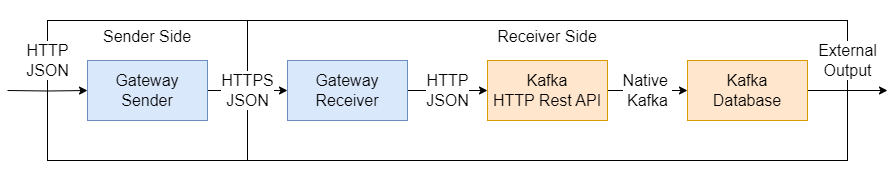

# Architecture Overview

The gateway consists of a sender gateway on the sender side and the receiving gateway on the receiver side.
Kafka does not natively support JSON objects send via HTTP REST, therefore a translation was provided by the Kafka 
developers to translate HTTP Rest API calls into native Kafka protocol communication.

The sender gateway receives IDMEFv2 as JSON formatet alert message via HTTP message. 
For testing or debugging curl scripts or the postman collection can be used for testing.
The gateway sender afterwards performs configured filtering or enrichment and forwards the 
alert to the receiver side gateway. 
Here the alert is also filtered or enriched as configured and afterwards sent to the Kafka HTTP Rest API container.
The Kafka REST API container does the translation to the final destination, the Kafka database which is locally 
reachable on the receiver side.

## TOC

Architecture Overview(here)

[Compilation Instructions](./compilaton.md)

[Configuration Instructions](./configuration.md)

[Demonstration (Getting Started)](./demonstration.md)

[Additional Links](./additional-links.md)