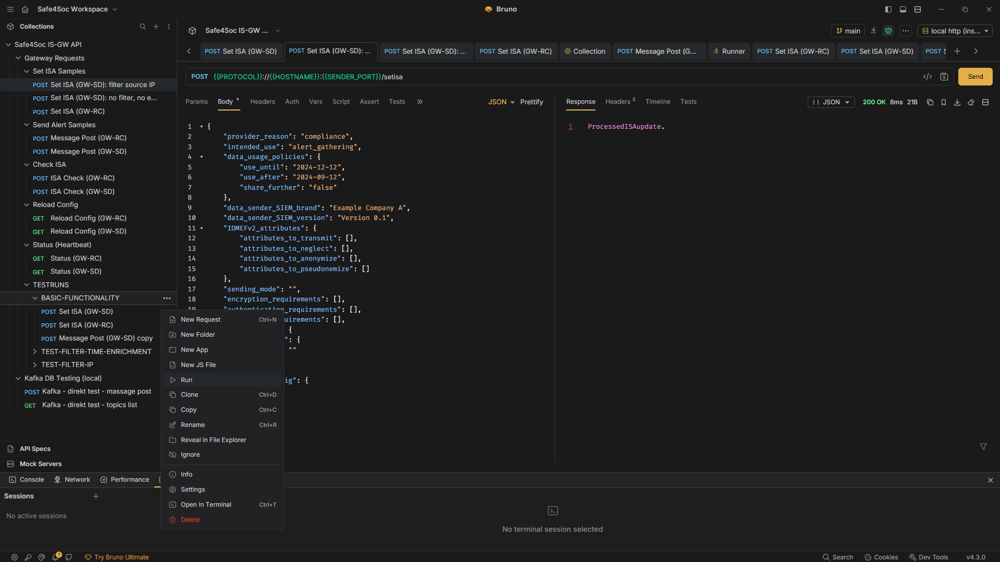

# Testing the Endpoints

## Bruno Client (highly recommended)

This section details how alerts can be sent through the gateways.

The gateways can be tested using Bruno Client collection
Get Bruno here: https://www.usebruno.com/
Once installed the testing collection located under ./api-testing which contains predefined REST API requests
can be imported via File(top left) -> Open Collection.



## Curl Commands wih Variables

The following sections show sample usages of the API using curl and command-line only.

set your variables either using .env file or directly using these commands:
```bash
PROTOCOL="https"        #http|https
URL="localhost:10080"   #gateway-sender:10080 | localhost:10080
TOPIC="alerts"
```

Create IDMEFv2 alert:
```bash
cat > idmefv2-test-alert.json <<'EOF'
{
    "Version": "2.D.V08",
    "ID": "9a3e8dbe-b90f-4d55-b45e-823f0e509a2f",
    "Status": [
        "Incident"
    ],
    "OrganisationName": "acme.eu",
    "CreateTime": "2026-11-10T10:00:30Z",
    "StartTime": "2026-11-10T10:00:30Z",
    "Cause": "Malicious",
    "Category": [
        "Theft.Machinery"
    ],
    "Confidence": 0.85,
    "Description": "Unauthorized removal of a secure laptop from a restricted server room detected via badge access logs and motion sensors.",
    "Analyzer": {
        "ID": "9a3e8dbe-b90f-4d55-b45e-823f0e509a21",
        "IP": "192.168.100.10",
        "Name": "Security Control Panel",
        "Hostname": "security-hub.acme.eu",
        "Model": "Honeywell Pro-Watch",
        "Category": [
            "ID.IAM"
        ],
        "Data": [
            "Contact",
            "Vibration"
        ],
        "Method": [
            "Threshold"
        ],
        "GeoLocation": "+41.9028,+12.4964,+50",
        "UnLocation": "IT ROM",
        "Location": "ACME-ROME-SERVER1"
    },
    "Sensor": [
        {
            "ID": "9a3e8dbe-b90f-4d55-b45e-823f0e509a22",
            "IP": "192.168.100.10",
            "Name": "Security Control Panel",
            "CaptureZone": "[{\"type\":\"physical-area\",\"spec_version\":\"2.1\",\"id\": \"physical-area--abcd1234-5678-90ef-abcd-1234567890ef\",\"value\": \"Server Room A - Floor 2\"}]"
        }
    ],
    "Source": [
        {
            "ID": "9a3e8dbe-b90f-4d55-b45e-823f0e509a23",
            "IP": "192.168.200.50",
            "Protocol": [
                "BadgeAccess"
            ]
        }
    ],
    "Target": [
        {
            "ID": "9a3e8dbe-b90f-4d55-b45e-823f0e509a24",
            "IP": "192.168.100.22",
            "Port": [],
            "Location": "Secure Server Room - Rack 5"
        }
    ]
}
EOF
```

Send the alert to the gateway using: 

```bash
curl -X POST -sS -v \
  --location "${PROTOCOL}://${URL}/topics/${TOPIC}" \
  --header 'Content-Type: application/vnd.kafka.json.v2+json' \
  --data @./idmefv2-test-alert.json
```

## Curl commands using all-in-one Commands

Alternatively here is an all-in-one command sample:

### HTTPS Message Post gateway-sender
<details>
<summary>Click to see HTTPS Message Post gateway-sender:</summary>

```bash
curl --location 'https://localhost:10080/topics/alerts' \
--header 'Content-Type: application/vnd.kafka.json.v2+json' \
--data '{
    "Version": "2.D.V08",
    "ID": "9a3e8dbe-b90f-4d55-b45e-823f0e509a2f",
    "Status": [
        "Incident"
    ],
    "OrganisationName": "acme.eu",
    "CreateTime": "2026-11-10T10:00:30Z",
    "StartTime": "2026-11-10T10:00:30Z",
    "Cause": "Malicious",
    "Category": [
        "Theft.Machinery"
    ],
    "Confidence": 0.85,
    "Description": "Unauthorized removal of a secure laptop from a restricted server room detected via badge access logs and motion sensors.",
    "Analyzer": {
        "ID": "9a3e8dbe-b90f-4d55-b45e-823f0e509a21",
        "IP": "192.168.100.10",
        "Name": "Security Control Panel",
        "Hostname": "security-hub.acme.eu",
        "Model": "Honeywell Pro-Watch",
        "Category": [
            "ID.IAM"
        ],
        "Data": [
            "Contact",
            "Vibration"
        ],
        "Method": [
            "Threshold"
        ],
        "GeoLocation": "+41.9028,+12.4964,+50",
        "UnLocation": "IT ROM",
        "Location": "ACME-ROME-SERVER1"
    },
    "Sensor": [
        {
            "ID": "9a3e8dbe-b90f-4d55-b45e-823f0e509a22",
            "IP": "192.168.100.10",
            "Name": "Security Control Panel",
            "CaptureZone": "[{\"type\":\"physical-area\",\"spec_version\":\"2.1\",\"id\": \"physical-area--abcd1234-5678-90ef-abcd-1234567890ef\",\"value\": \"Server Room A - Floor 2\"}]"
        }
    ],
    "Source": [
        {
            "ID": "9a3e8dbe-b90f-4d55-b45e-823f0e509a23",
            "IP": "192.168.200.50",
            "Protocol": [
                "BadgeAccess"
            ]
        }
    ],
    "Target": [
        {
            "ID": "9a3e8dbe-b90f-4d55-b45e-823f0e509a24",
            "IP": "192.168.100.22",
            "Port": [],
            "Location": "Secure Server Room - Rack 5"
        }
    ]
}'
```
</details>

### HTTPS Message Post gateway-receiver
<details>
<summary>Click to see HTTPS Message Post gateway-receiver:</summary>

```bash
curl --location 'https://localhost:10081/topics/alerts' \
--header 'Content-Type: application/vnd.kafka.json.v2+json' \
--data '{
    "Version": "2.D.V08",
    "ID": "9a3e8dbe-b90f-4d55-b45e-823f0e509a2f",
    "Status": [
        "Incident"
    ],
    "OrganisationName": "acme.eu",
    "CreateTime": "2026-11-10T10:00:30Z",
    "StartTime": "2026-05-15T13:49:55Z",
    "Cause": "Malicious",
    "Category": [
        "Theft.Machinery"
    ],
    "Priority": "High",
    "Confidence": 0.85,
    "Description": "Unauthorized removal of a secure laptop from a restricted server room detected via badge access logs and motion sensors.",
    "Analyzer": {
        "ID": "9a3e8dbe-b90f-4d55-b45e-823f0e509a21",
        "IP": "192.168.100.10",
        "Name": "Security Control Panel",
        "Hostname": "security-hub.acme.eu",
        "Model": "Honeywell Pro-Watch",
        "Category": [
            "ID.IAM"
        ],
        "Data": [
            "Contact",
            "Vibration"
        ],
        "Method": [
            "Threshold"
        ],
        "GeoLocation": "+41.9028,+12.4964,+50",
        "UnLocation": "IT ROM",
        "Location": "ACME-ROME-SERVER1"
    },
    "Sensor": [
        {
            "ID": "9a3e8dbe-b90f-4d55-b45e-823f0e509a22",
            "IP": "192.168.100.10",
            "Name": "Security Control Panel",
            "CaptureZone": "[{\"type\":\"physical-area\",\"spec_version\":\"2.1\",\"id\": \"physical-area--abcd1234-5678-90ef-abcd-1234567890ef\",\"value\": \"Server Room A - Floor 2\"}]"
        }
    ],
    "Source": [
        {
            "ID": "9a3e8dbe-b90f-4d55-b45e-823f0e509a23",
            "IP": "192.168.200.50",
            "Protocol": [
                "BadgeAccess"
            ]
        }
    ],
    "Target": [
        {
            "ID": "9a3e8dbe-b90f-4d55-b45e-823f0e509a24",
            "IP": "192.168.100.22",
            "Port": [],
            "Location": "Secure Server Room - Rack 5"
        }
    ]
}'
```
</details>

### HTTP Message Post gateway-sender
<details>
<summary>Click to see HTTP Message Post gateway-sender:</summary>

```bash
curl --location 'http://localhost:10080/topics/alerts' \
--header 'Content-Type: application/vnd.kafka.json.v2+json' \
--data '{
  "Version": "2.D.V04",
  "ID": "e5f9bbae-163e-42f9-a2f2-0daaf78fefb1",
  "Status": "Incident",
  "OrganisationName": "acme.eu",
  "CreateTime": "",
  "StartTime": "2021-01-18T23:33:04.52Z",
  "Cause": "Malicious",
  "Category": [
    "Recon.Scanning"
  ],
  "Priority": "Medium",
  "Confidence": 0.9,
  "Description": "An IDS event of type \"Unknown IP Protocol\" was observed",
  "Analyzer": {
    "IP": "172.10.5.31",
    "Name": "Core router",
    "Hostname": "core-router.example.com",
    "Type": "Cyber",
    "Model": "Cisco 4532",
    "Category": [
      "NIDS"
    ],
    "Data": [
      "Datagram"
    ],
    "Method": [
      "signature"
    ],
    "GeoLocation": "+48.75726,+2.299528,+65.1",
    "UnLocation": "GR ATH",
    "Location": "SBDX1"
  },
  "Sensor": [
    {
      "IP": "172.10.5.31",
      "Name": "Core router",
      "CaptureZone": "[{\"type\":\"ipv4-addr\",\"spec_version\":\"2.1\",\"id\": \"ipv4-addr--ff26c055-6336-5bc5-b98d-13d6226742dd\",\"value\": \"172.17.0.0\"},{\"type\":\"ipv4-net-mask\",\"spec_version\":\"2.1\",\"id\":\"ipv4-net-mask--ff26c055-6336-5bc5-b98d-13d6226742dd\",\"value\":\"255.255.0.0\"}]"
    }
  ],
  "Source": [
    {
      "IP": "77.222.222.115",
      "Protocol": [
        "Unknown"
      ]
    }
  ],
  "Target": [
    {
      "IP": "172.20.7.25",
      "Port": [
        645
      ],
      "Location": "Datacenter SBX1"
    }
  ]
}'
```
</details>

### HTTP Message Post gateway-receiver
<details>
<summary>Click to see HTTP Message Post gateway-receiver:</summary>

```bash
curl --location 'http://localhost:10081/topics/alerts' \
--header 'Content-Type: application/vnd.kafka.json.v2+json' \
--data '{
  "Version": "2.D.V04",
  "ID": "e5f9bbae-163e-42f9-a2f2-0daaf78fefb1",
  "Status": "Incident",
  "OrganisationName": "acme.eu",
  "CreateTime": "",
  "StartTime": "2021-01-18T23:33:04.52Z",
  "Cause": "Malicious",
  "Category": [
    "Recon.Scanning"
  ],
  "Priority": "Medium",
  "Confidence": 0.9,
  "Description": "An IDS event of type \"Unknown IP Protocol\" was observed",
  "Analyzer": {
    "IP": "172.10.5.31",
    "Name": "Core router",
    "Hostname": "core-router.example.com",
    "Type": "Cyber",
    "Model": "Cisco 4532",
    "Category": [
      "NIDS"
    ],
    "Data": [
      "Datagram"
    ],
    "Method": [
      "signature"
    ],
    "GeoLocation": "+48.75726,+2.299528,+65.1",
    "UnLocation": "GR ATH",
    "Location": "SBDX1"
  },
  "Sensor": [
    {
      "IP": "172.10.5.31",
      "Name": "Core router",
      "CaptureZone": "[{\"type\":\"ipv4-addr\",\"spec_version\":\"2.1\",\"id\": \"ipv4-addr--ff26c055-6336-5bc5-b98d-13d6226742dd\",\"value\": \"172.17.0.0\"},{\"type\":\"ipv4-net-mask\",\"spec_version\":\"2.1\",\"id\":\"ipv4-net-mask--ff26c055-6336-5bc5-b98d-13d6226742dd\",\"value\":\"255.255.0.0\"}]"
    }
  ],
  "Source": [
    {
      "IP": "77.222.222.115",
      "Protocol": [
        "Unknown"
      ]
    }
  ],
  "Target": [
    {
      "IP": "172.20.7.25",
      "Port": [
        645
      ],
      "Location": "Datacenter SBX1"
    }
  ]
}'
```
</details>

## Additional API endpoints

### Reload config
```bash
curl --location 'https://localhost:10080/reloadconfig' \
--data ''
```

### Status (Heartbeat)

```bash
curl --location 'https://localhost:10080/status' \
--data ''
```

### Set ISA

```bash
curl --location 'https://localhost:10080/setisa' \
--header 'Content-Type: application/json' \
--data '{
    "provider_reason": "compliance",
    "intended_use": "alert_gathering",
    "data_usage_policies": {
        "use_until": "2024-12-12",
        "use_after": "2024-09-12",
        "share_further": "false"
    },
    "data_sender_SIEM_brand": "Example Company A",
    "data_sender_SIEM_version": "Version 0.1",
    "IDMEFv2_attributes": {
        "attributes_to_transmit": [],
        "attributes_to_neglect": [],
        "attributes_to_anonymize": [],
        "attributes_to_pseudonemize": []
    },
    "sending_mode": "",
    "encryption_requirements": [],
    "authentication_requirements": [],
    "connection_requirements": [],
    "filterConfig": {
           "Version": "",
            "ID": ""
    },
    "enrichmentConfig": {
        "CreateTime": "",
        "StartTime": ""
    }
}'
```

### Kafka direct test message list

```bash
curl --location 'http://localhost:8082/topics'
```

### Kafka direct test message post

```bash
curl --location 'http://localhost:8082/topics/alerts' \
--header 'Content-Type: application/vnd.kafka.json.v2+json' \
--data '{
    "records": [
        {
            "key":"test",
            "value":
                {
                    "Version": "2.D.V04",
                    "ID": "e5f9bbae-163e-42f9-a2f2-0daaf78fefb1",
                    "Status": "Incident",
                    "OrganisationName": "acme.eu",
                    "CreateTime": "",
                    "StartTime": "2021-01-18T23:33:04.52Z",
                    "Cause": "Malicious",
                    "Category": [
                        "Recon.Scanning"
                    ],
                    "Priority": "Medium",
                    "Confidence": 0.9,
                    "Description": "An IDS event of type \"Unknown IP Protocol\" was observed",
                    "Analyzer": {
                        "IP": "172.10.5.31",
                        "Name": "Core router",
                        "Hostname": "core-router.example.com",
                        "Type": "Cyber",
                        "Model": "Cisco 4532",
                        "Category": [
                        "NIDS"
                        ],
                        "Data": [
                        "Datagram"
                        ],
                        "Method": [
                        "signature"
                        ],
                        "GeoLocation": "+48.75726,+2.299528,+65.1",
                        "UnLocation": "GR ATH",
                        "Location": "SBDX1"
                    },
                    "Sensor": [
                        {
                        "IP": "172.10.5.31",
                        "Name": "Core router",
                        "CaptureZone": "[{\"type\":\"ipv4-addr\",\"spec_version\":\"2.1\",\"id\": \"ipv4-addr--ff26c055-6336-5bc5-b98d-13d6226742dd\",\"value\": \"172.17.0.0\"},{\"type\":\"ipv4-net-mask\",\"spec_version\":\"2.1\",\"id\":\"ipv4-net-mask--ff26c055-6336-5bc5-b98d-13d6226742dd\",\"value\":\"255.255.0.0\"}]"
                        }
                    ],
                    "Source": [
                        {
                        "IP": "77.222.222.115",
                        "Protocol": [
                            "Unknown"
                        ]
                        }
                    ],
                    "Target": [
                        {
                        "IP": "172.20.7.25",
                        "Port": [
                            645
                        ],
                        "Location": "Datacenter SBX1"
                        }
                    ]
                }
            
        }
    ]
}'
```


## Complete Examples

### Filtering and Enrichment

When the Gateway receives the following IDMEFv2 message:

<details>
<summary>Click to see sample alert:</summary>

```                                    
{
  "Version": "2.D.V04",
  "ID": "e5f9bbae-163e-42f9-a2f2-0daaf78fefb1",
  "Status": "Incident",
  "OrganisationName": "acme.eu",
  "CreateTime": "",
  "StartTime": "2021-01-18T23:33:04.52Z",
  "Cause": "Malicious",
  "Category": [
    "Recon.Scanning"
  ],
  "Priority": "Medium",
  "Confidence": 0.9,
  "Description": "An IDS event of type \"Unknown IP Protocol\" was observed",
  "Analyzer": {
    "IP": "172.10.5.31",
    "Name": "Core router",
    "Hostname": "core-router.example.com",
    "Type": "Cyber",
    "Model": "Cisco 4532",
    "Category": [
      "NIDS"
    ],
    "Data": [
      "Datagram"
    ],
    "Method": [
      "signature"
    ],
    "GeoLocation": "+48.75726,+2.299528,+65.1",
    "UnLocation": "GR ATH",
    "Location": "SBDX1"
  },
  "Sensor": [
    {
      "IP": "172.10.5.31",
      "Name": "Core router",
      "CaptureZone": "[{\"type\":\"ipv4-addr\",\"spec_version\":\"2.1\",\"id\": \"ipv4-addr--ff26c055-6336-5bc5-b98d-13d6226742dd\",\"value\": \"172.17.0.0\"},{\"type\":\"ipv4-net-mask\",\"spec_version\":\"2.1\",\"id\":\"ipv4-net-mask--ff26c055-6336-5bc5-b98d-13d6226742dd\",\"value\":\"255.255.0.0\"}]"
    }
  ],
  "Source": [
    {
      "IP": "77.222.222.115",
      "Protocol": [
        "Unknown"
      ]
    }
  ],
  "Target": [
    {
      "IP": "172.20.7.25",
      "Port": [
        645
      ],
      "Location": "Datacenter SBX1"
    }
  ]
}
```
</details>

using the filter all configuration in ISA:

<details>
<summary>Click to see filter example ISA:</summary>

```    
{
  "provider_reason": "compliance",
  "intended_use": "alert_gathering",
  "data_usage_policies": {
    "use_until": "2024-12-12",
    "use_after": "2024-09-12",
    "share_further": false
  },
  "data_sender_SIEM_brand": "Example Company A",
  "data_sender_SIEM_version": "Version 0.1",
  "IDMEFv2_attributes": {
    "attributes_to_transmit": [],
    "attributes_to_neglect": [],
    "attributes_to_anonymize": [],
    "attributes_to_pseudonemize": []
  },
  "sending_mode": "",
  "encryption_requirements": [],
  "authentication_requirements": [],
  "connection_requirements": [],
  "filterConfig": {
    "Version": "",
    "ID": "",
    "Status": "",
    "OrganisationName": "",
    "CreateTime": "",
    "StartTime": "",
    "Cause": "",
    "Category": "",
    "Priority": "",
    "Confidence": "",
    "Description": "",
    "Analyzer": {
      "IP": "",
      "Name": "",
      "Hostname": "",
      "Type": "",
      "Model": "",
      "Category": "",
      "Data": "",
      "Method": "",
      "GeoLocation": "",
      "UnLocation": "",
      "Location": ""
    },
    "Sensor": "",
    "Source": {
      "IP": "",
      "Protocol": ""
    },
    "Target": ""
  },
    "enrichmentConfig": {
    "CreateTime": "",
    "StartTime": ""
  }
}

```
</details>

Then the alert output will be:


<details>
<summary>Click to see filter example ISA:</summary>


```
{
  "Status": "",
  "Category": [],
  "Description": "",
  "Priority": "",
  "CreateTime": "",
  "StartTime": "",
  "Analyzer": {
    "Type": "",
    "Category": [],
    "IP": "",
    "Hostname": "",
    "Model": "",
    "Data": [],
    "UnLocation": "",
    "Method": [],
    "GeoLocation": "",
    "Name": "",
    "Location": ""
  },
  "Source": [],
  "Target": [],
  "Version": "",
  "Confidence": "",
  "Cause": "",
  "OrganisationName": "",
  "ID": "",
  "Sensor": []
}
```
Please note that the fields CreateTime and StartTime are enriched by the gateway, if no entry was found.
Enrichment of timestamps can be made and look like this:
```
  "CreateTime": "2025-04-02T09:16:57.16Z",
  "StartTime": "2025-04-02T09:16:57.69Z",
```

</details>


### Dropping Example

When the Gateway receives the following IDMEFv2 message:

<details>
<summary>Click to see sample alert:</summary>

```json                             
{
    "Version": "2.D.V08",
    "ID": "9a3e8dbe-b90f-4d55-b45e-823f0e509a2f",
    "Status": [
        "Incident"
    ],
    "OrganisationName": "acme.eu",
    "CreateTime": "2026-11-10T10:00:30Z",
    "StartTime": "2026-05-15T13:49:55Z",
    "Cause": "Malicious",
    "Category": [
        "Theft.Machinery"
    ],
    "Priority": "High",
    "Confidence": 0.85,
    "Description": "Unauthorized removal of a secure laptop from a restricted server room detected via badge access logs and motion sensors.",
    "Analyzer": {
        "ID": "9a3e8dbe-b90f-4d55-b45e-823f0e509a21",
        "IP": "192.168.100.10",
        "Name": "Security Control Panel",
        "Hostname": "security-hub.acme.eu",
        "Model": "Honeywell Pro-Watch",
        "Category": [
            "ID.IAM"
        ],
        "Data": [
            "Contact",
            "Vibration"
        ],
        "Method": [
            "Threshold"
        ],
        "GeoLocation": "+41.9028,+12.4964,+50",
        "UnLocation": "IT ROM",
        "Location": "ACME-ROME-SERVER1"
    },
    "Sensor": [
        {
            "ID": "9a3e8dbe-b90f-4d55-b45e-823f0e509a22",
            "IP": "192.168.100.10",
            "Name": "Security Control Panel",
            "CaptureZone": "[{\"type\":\"physical-area\",\"spec_version\":\"2.1\",\"id\": \"physical-area--abcd1234-5678-90ef-abcd-1234567890ef\",\"value\": \"Server Room A - Floor 2\"}]"
        }
    ],
    "Source": [
        {
            "ID": "9a3e8dbe-b90f-4d55-b45e-823f0e509a23",
            "IP": "192.168.200.50",
            "Protocol": [
                "BadgeAccess"
            ]
        }
    ],
    "Target": [
        {
            "ID": "9a3e8dbe-b90f-4d55-b45e-823f0e509a24",
            "IP": "192.168.100.22",
            "Port": [],
            "Location": "Secure Server Room - Rack 5"
        }
    ]
}
```
</details>

using the drop configuration in ISA:

<details>
<summary>Click to see filter example ISA:</summary>

```json    
{
  "provider_reason": "compliance",
  "intended_use": "alert_gathering",
  "data_usage_policies": {
    "use_until": "2024-12-12",
    "use_after": "2024-09-12",
    "share_further": "false"
  },
  "data_sender_SIEM_brand": "Example Company A",
  "data_sender_SIEM_version": "Version 0.1",
  "IDMEFv2_attributes": {
    "attributes_to_transmit": [],
    "attributes_to_neglect": [],
    "attributes_to_anonymize": [],
    "attributes_to_pseudonemize": []
  },
  "sending_mode": "",
  "encryption_requirements": [],
  "authentication_requirements": [],
  "connection_requirements": [],
  "filterConfig": {
    "CreateTime": "",
    "StartTime": ""
  },
  "dropConfig": {
    "Version": "",
    "ID": "",
    "Status": "",
    "OrganisationName": "",
    "CreateTime": "",
    "StartTime": "",
    "Cause": "",
    "Category": "",
    "Priority": "High",
    "Confidence": "",
    "Description": ""
  },
  "enrichmentConfig": {
    "CreateTime": "",
    "StartTime": ""
  },
  "requiredConfig": {
    "Version": "",
    "ID": "",
    "StartTime": "",
    "Status": "",
    "Source": "",
    "Target": ""
  }
}

```
</details>

Then the alert output will be:

<details>
<summary>Click to see filter example ISA:</summary>

```
422 Unprocessable Entity
Alert rejected: forbidden value found in Priority
```
And the gateway log will be:
```
gateway-receiver-1  | 2026-11-23T12:47:01.228Z  INFO 1 --- [s4s-gateway] [io-10081-exec-9] d.f.aisec.s4sgateway.Controller          : Alert is valid JSON.
gateway-receiver-1  | 2026-11-23T12:47:01.228Z  INFO 1 --- [s4s-gateway] [io-10081-exec-9] d.f.aisec.s4sgateway.Controller          : Alert is valid against configured JSON schema.
gateway-receiver-1  | 2026-11-23T12:47:01.228Z DEBUG 1 --- [s4s-gateway] [io-10081-exec-9] d.f.aisec.s4sgateway.Controller          : Checking the key Status for drop instructions.
gateway-receiver-1  | 2026-11-23T12:47:01.228Z DEBUG 1 --- [s4s-gateway] [io-10081-exec-9] d.f.aisec.s4sgateway.Controller          : Checking the key Category for drop instructions.
gateway-receiver-1  | 2026-11-23T12:47:01.228Z DEBUG 1 --- [s4s-gateway] [io-10081-exec-9] d.f.aisec.s4sgateway.Controller          : Checking the key Description for drop instructions.
gateway-receiver-1  | 2026-11-23T12:47:01.228Z DEBUG 1 --- [s4s-gateway] [io-10081-exec-9] d.f.aisec.s4sgateway.Controller          : Checking the key Version for drop instructions.
gateway-receiver-1  | 2026-11-23T12:47:01.228Z DEBUG 1 --- [s4s-gateway] [io-10081-exec-9] d.f.aisec.s4sgateway.Controller          : Checking the key Confidence for drop instructions.
gateway-receiver-1  | 2026-11-23T12:47:01.228Z DEBUG 1 --- [s4s-gateway] [io-10081-exec-9] d.f.aisec.s4sgateway.Controller          : Checking the key Priority for drop instructions.
gateway-receiver-1  | 2026-11-23T12:47:01.228Z  INFO 1 --- [s4s-gateway] [io-10081-exec-9] d.f.aisec.s4sgateway.Controller          : Dropped alert due to triggered drop configuration at key: Priority
gateway-receiver-1  | 2026-11-23T12:47:01.228Z  WARN 1 --- [s4s-gateway] [io-10081-exec-9] d.f.aisec.s4sgateway.Controller          : Alert rejected: forbidden value found in Priority.
```
</details>


### Required Example

When the Gateway receives the following IDMEFv2 message with missing StartTime-field:

<details>
<summary>Click to see sample alert:</summary>

```json                             
{
  "Version": "2.D.V08",
  "ID": "9a3e8dbe-b90f-4d55-b45e-823f0e509a2f",
  "Status": [
    "Incident"
  ],
  "OrganisationName": "acme.eu",
  "CreateTime": "2026-11-10T10:00:30Z",
  "Cause": "Malicious",
  "Category": [
    "Theft.Machinery"
  ],
  "Priority": "Medium",
  "Confidence": 0.85,
  "Description": "Unauthorized removal of a secure laptop from a restricted server room detected via badge access logs and motion sensors.",
  "Analyzer": {
    "ID": "9a3e8dbe-b90f-4d55-b45e-823f0e509a21",
    "IP": "192.168.100.10",
    "Name": "Security Control Panel",
    "Hostname": "security-hub.acme.eu",
    "Model": "Honeywell Pro-Watch",
    "Category": [
      "ID.IAM"
    ],
    "Data": [
      "Contact",
      "Vibration"
    ],
    "Method": [
      "Threshold"
    ],
    "GeoLocation": "+41.9028,+12.4964,+50",
    "UnLocation": "IT ROM",
    "Location": "ACME-ROME-SERVER1"
  },
  "Sensor": [
    {
      "ID": "9a3e8dbe-b90f-4d55-b45e-823f0e509a22",
      "IP": "192.168.100.10",
      "Name": "Security Control Panel",
      "CaptureZone": "[{\"type\":\"physical-area\",\"spec_version\":\"2.1\",\"id\": \"physical-area--abcd1234-5678-90ef-abcd-1234567890ef\",\"value\": \"Server Room A - Floor 2\"}]"
    }
  ],
  "Source": [
    {
      "ID": "9a3e8dbe-b90f-4d55-b45e-823f0e509a23",
      "IP": "192.168.200.50",
      "Protocol": [
        "BadgeAccess"
      ]
    }
  ],
  "Target": [
    {
      "ID": "9a3e8dbe-b90f-4d55-b45e-823f0e509a24",
      "IP": "192.168.100.22",
      "Port": [],
      "Location": "Secure Server Room - Rack 5"
    }
  ]
}
```
</details>

using the drop configuration in ISA:

<details>
<summary>Click to see filter example ISA:</summary>

```json    
{
  "provider_reason": "compliance",
  "intended_use": "alert_gathering",
  "data_usage_policies": {
    "use_until": "2024-12-12",
    "use_after": "2024-09-12",
    "share_further": "false"
  },
  "data_sender_SIEM_brand": "Example Company A",
  "data_sender_SIEM_version": "Version 0.1",
  "IDMEFv2_attributes": {
    "attributes_to_transmit": [],
    "attributes_to_neglect": [],
    "attributes_to_anonymize": [],
    "attributes_to_pseudonemize": []
  },
  "sending_mode": "",
  "encryption_requirements": [],
  "authentication_requirements": [],
  "connection_requirements": [],
  "filterConfig": {
    "CreateTime": "",
    "StartTime": ""
  },
  "dropConfig": {
    "Version": "",
    "ID": "",
    "Status": "",
    "OrganisationName": "",
    "CreateTime": "",
    "StartTime": "",
    "Cause": "",
    "Category": "",
    "Priority": "High",
    "Confidence": "",
    "Description": ""
  },
  "enrichmentConfig": {
    "CreateTime": "",
    "StartTime": ""
  },
  "requiredConfig": {
    "Version": "",
    "ID": "",
    "StartTime": "",
    "Status": "",
    "Source": "",
    "Target": ""
  }
}

```
</details>

Then the alert output will be:

<details>
<summary>Click to see filter example ISA:</summary>

```
422 Unprocessable Entity
Alert rejected: missing mandatory field StartTime
```
Because the schema does not work for IDMEFv2 JSON schema 8 and the gateway log will be:
```
gateway-receiver-1  | 2026-11-23T12:56:55.604Z  INFO 1 --- [s4s-gateway] [io-10081-exec-5] d.f.aisec.s4sgateway.Controller          : Alert is valid JSON.
gateway-receiver-1  | 2026-11-23T12:56:55.604Z  INFO 1 --- [s4s-gateway] [io-10081-exec-5] d.f.aisec.s4sgateway.Controller          : Alert is valid against configured JSON schema.
gateway-receiver-1  | 2026-11-23T12:56:55.604Z DEBUG 1 --- [s4s-gateway] [io-10081-exec-5] d.f.aisec.s4sgateway.Controller          : Checking the key Status for drop instructions.
gateway-receiver-1  | 2026-11-23T12:56:55.604Z DEBUG 1 --- [s4s-gateway] [io-10081-exec-5] d.f.aisec.s4sgateway.Controller          : Checking the key Category for drop instructions.
gateway-receiver-1  | 2026-11-23T12:56:55.604Z DEBUG 1 --- [s4s-gateway] [io-10081-exec-5] d.f.aisec.s4sgateway.Controller          : Checking the key Description for drop instructions.
gateway-receiver-1  | 2026-11-23T12:56:55.604Z DEBUG 1 --- [s4s-gateway] [io-10081-exec-5] d.f.aisec.s4sgateway.Controller          : Checking the key Version for drop instructions.
gateway-receiver-1  | 2026-11-23T12:56:55.604Z DEBUG 1 --- [s4s-gateway] [io-10081-exec-5] d.f.aisec.s4sgateway.Controller          : Checking the key Confidence for drop instructions.
gateway-receiver-1  | 2026-11-23T12:56:55.604Z DEBUG 1 --- [s4s-gateway] [io-10081-exec-5] d.f.aisec.s4sgateway.Controller          : Checking the key Priority for drop instructions.
gateway-receiver-1  | 2026-11-23T12:56:55.604Z DEBUG 1 --- [s4s-gateway] [io-10081-exec-5] d.f.aisec.s4sgateway.Controller          : Checking the key CreateTime for drop instructions.
gateway-receiver-1  | 2026-11-23T12:56:55.604Z DEBUG 1 --- [s4s-gateway] [io-10081-exec-5] d.f.aisec.s4sgateway.Controller          : Checking the key Cause for drop instructions.
gateway-receiver-1  | 2026-11-23T12:56:55.604Z DEBUG 1 --- [s4s-gateway] [io-10081-exec-5] d.f.aisec.s4sgateway.Controller          : Checking the key StartTime for drop instructions.
gateway-receiver-1  | 2026-11-23T12:56:55.604Z DEBUG 1 --- [s4s-gateway] [io-10081-exec-5] d.f.aisec.s4sgateway.Controller          : Checking the key OrganisationName for drop instructions.
gateway-receiver-1  | 2026-11-23T12:56:55.604Z DEBUG 1 --- [s4s-gateway] [io-10081-exec-5] d.f.aisec.s4sgateway.Controller          : Checking the key ID for drop instructions.
gateway-receiver-1  | 2026-11-23T12:56:55.605Z DEBUG 1 --- [s4s-gateway] [io-10081-exec-5] d.f.aisec.s4sgateway.Controller          : Checking mandatory field config at key: Status
gateway-receiver-1  | 2026-11-23T12:56:55.605Z DEBUG 1 --- [s4s-gateway] [io-10081-exec-5] d.f.aisec.s4sgateway.Controller          : Checking mandatory field config at key: Target
gateway-receiver-1  | 2026-11-23T12:56:55.605Z DEBUG 1 --- [s4s-gateway] [io-10081-exec-5] d.f.aisec.s4sgateway.Controller          : Checking mandatory field config at key: Version
gateway-receiver-1  | 2026-11-23T12:56:55.605Z DEBUG 1 --- [s4s-gateway] [io-10081-exec-5] d.f.aisec.s4sgateway.Controller          : Checking mandatory field config at key: StartTime
gateway-receiver-1  | 2026-11-23T12:56:55.605Z  WARN 1 --- [s4s-gateway] [io-10081-exec-5] d.f.aisec.s4sgateway.Controller          : Alert rejected: missing mandatory field StartTime.
```
</details>


### IDMEFv2 Schema Example

When the Gateway receives the following IDMEFv2 message with malformed (empty) StartTime:

<details>
<summary>Click to see sample alert:</summary>

```json                             
{
    "Version": "2.D.V08",
    "ID": "9a3e8dbe-b90f-4d55-b45e-823f0e509a2f",
    "Status": [
        "Incident"
    ],
    "OrganisationName": "acme.eu",
    "CreateTime": "2026-11-10T10:00:30Z",
    "StartTime": "",
    "Cause": "Malicious",
    "Category": [
        "Theft.Machinery"
    ],
    "Priority": "High",
    "Confidence": 0.85,
    "Description": "Unauthorized removal of a secure laptop from a restricted server room detected via badge access logs and motion sensors.",
    "Analyzer": {
        "ID": "9a3e8dbe-b90f-4d55-b45e-823f0e509a21",
        "IP": "192.168.100.10",
        "Name": "Security Control Panel",
        "Hostname": "security-hub.acme.eu",
        "Model": "Honeywell Pro-Watch",
        "Category": [
            "ID.IAM"
        ],
        "Data": [
            "Contact",
            "Vibration"
        ],
        "Method": [
            "Threshold"
        ],
        "GeoLocation": "+41.9028,+12.4964,+50",
        "UnLocation": "IT ROM",
        "Location": "ACME-ROME-SERVER1"
    },
    "Sensor": [
        {
            "ID": "9a3e8dbe-b90f-4d55-b45e-823f0e509a22",
            "IP": "192.168.100.10",
            "Name": "Security Control Panel",
            "CaptureZone": "[{\"type\":\"physical-area\",\"spec_version\":\"2.1\",\"id\": \"physical-area--abcd1234-5678-90ef-abcd-1234567890ef\",\"value\": \"Server Room A - Floor 2\"}]"
        }
    ],
    "Source": [
        {
            "ID": "9a3e8dbe-b90f-4d55-b45e-823f0e509a23",
            "IP": "192.168.200.50",
            "Protocol": [
                "BadgeAccess"
            ]
        }
    ],
    "Target": [
        {
            "ID": "9a3e8dbe-b90f-4d55-b45e-823f0e509a24",
            "IP": "192.168.100.22",
            "Port": [],
            "Location": "Secure Server Room - Rack 5"
        }
    ]
}
```
</details>

using the configuration in ISA:

<details>
<summary>Click to see filter example ISA:</summary>

```json    
{
  "provider_reason": "compliance",
  "intended_use": "alert_gathering",
  "data_usage_policies": {
    "use_until": "2024-12-12",
    "use_after": "2024-09-12",
    "share_further": "false"
  },
  "data_sender_SIEM_brand": "Example Company A",
  "data_sender_SIEM_version": "Version 0.1",
  "IDMEFv2_attributes": {
    "attributes_to_transmit": [],
    "attributes_to_neglect": [],
    "attributes_to_anonymize": [],
    "attributes_to_pseudonemize": []
  },
  "sending_mode": "",
  "encryption_requirements": [],
  "authentication_requirements": [],
  "connection_requirements": [],
  "filterConfig": {
    "CreateTime": "",
    "StartTime": ""
  },
  "dropConfig": {
    "Version": "",
    "ID": "",
    "Status": "",
    "OrganisationName": "",
    "CreateTime": "",
    "StartTime": "",
    "Cause": "",
    "Category": "",
    "Priority": "High",
    "Confidence": "",
    "Description": ""
  },
  "enrichmentConfig": {
    "CreateTime": "",
    "StartTime": ""
  },
  "requiredConfig": {
    "Version": "",
    "ID": "",
    "StartTime": "",
    "Status": "",
    "Source": "",
    "Target": ""
  }
}

```
</details>

Then the alert output will be:

<details>
<summary>Click to see filter example ISA:</summary>

```
422 Unprocessable Entity
[/StartTime: does not match the regex pattern ^[0-9]{4}-(0[0-9]|1[012])-([0-2][0-9]|3[01])T([0-1][0-9]|2[0-3]):[0-5][0-9]:([0-5][0-9]|60)(\.[0-9]+)?(Z|[-+]([0-1][0-9]|2[0-3]):[0-5][0-9])?$]
```
Because the schema does not work for IDMEFv2 JSON schema 8 and the gateway log will be:
```
gateway-receiver-1  | 2026-11-23T12:52:02.003Z  INFO 1 --- [s4s-gateway] [io-10081-exec-2] d.f.aisec.s4sgateway.Controller          : Alert is valid JSON.
gateway-receiver-1  | 2026-11-23T12:52:02.003Z ERROR 1 --- [s4s-gateway] [io-10081-exec-2] d.f.aisec.s4sgateway.Controller          : [/StartTime: does not match the regex pattern ^[0-9]{4}-(0[0-9]|1[012])-([0-2][0-9]|3[01])T([0-1][0-9]|2[0-3]):[0-5][0-9]:([0-5][0-9]|60)(\.[0-9]+)?(Z|[-+]([0-1][0-9]|2[0-3]):[0-5][0-9])?$]
```
</details>
